# Prompt Library — ChatGPT image generation

Use these as two independent pieces: a character and scene prompt for the gallery example, and a visual style prompt for the rendering treatment. To make your own image in a style, write your own subject description and paste only that style's prompt after it. To approach a gallery example, paste the shared character and scene prompt followed by its style prompt.

Copy-ready prompts are English in both display languages. Every current sample was generated with the same English technique and shared subject instructions available from its full-sample copy action. Earlier Japanese-generated samples have been replaced, and their records are archived in site/provenance/. The exact submitted text and each current image checksum are recorded in [`site/benchmark-manifest.json`](site/benchmark-manifest.json). The image tool did not expose a seed or underlying model version, so the same prompt can produce a different composition on another run.

Text prompts target the visible technique, not an identical image. For a closer match to a gallery image, attach that image in ChatGPT as a visual reference and say to preserve its medium, mark making, palette, and texture while following your subject description. Keep the same image model and output shape when comparing results, then inspect repeated generations. [OpenAI's image prompting guide](https://developers.openai.com/api/docs/guides/image-prompting) describes reference-based edits and consistency checks.

## Character and scene — shared benchmark

Benchmark ID: `station-map-v3` · Version: `3.0`. This prompt deliberately contains the person, pose, setting, and composition. It can be replaced in full when you want a different subject.

```text
Create one wide 16:9 landscape image, with no border or typography. A young adult East Asian woman with shoulder-length dark brown hair blowing gently to the left and expressive brown eyes wears a rust-red hooded coat and a black backpack. She holds an unfolded paper map in both hands at chest level, with the entire map visible near the lower edge. Frame her from the waist up in a medium close-up, slightly left of center: her head, torso, and map should fill most of the left half of the image. Her body is turned three-quarters to the right, and she looks up toward the right with a curious, slightly uncertain expression. She stands on a sunlit outdoor commuter-train platform. A long white commuter train with a muted teal stripe remains clearly visible across the right half of the background. The platform canopy and columns recede diagonally from the upper left; a few indistinct commuters stand far behind her. Keep the woman, map, platform, and train all clearly visible.
```

## Visual style prompts

### Watercolor

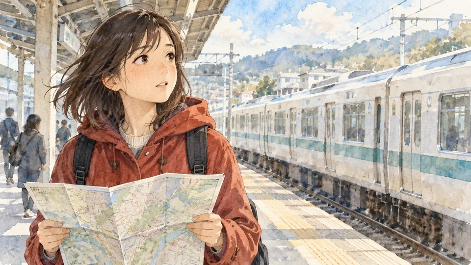

Transparent washes let the paper glow through, while water softens boundaries and gathers pigment at the edges.

Copy this section by itself after your own subject description. It intentionally does not describe the gallery character or train platform.

```text
Render the subject as a hand-painted watercolor illustration with contemporary Japanese animation-inspired drawing when people appear: simplified expressive faces and very fine pencil-like contours, never photorealistic skin. Layer transparent pigment over visible cold-press paper. Let pale powder-blue and warm beige washes bleed and pool softly in the background while retaining crisp, delicate detail at the focal face and hands. Leave luminous paper-white highlights and use one richer warm accent from the subject. The result should feel airy and visibly painted with water. Avoid realistic portrait rendering, opaque digital paint, thick black outlines, and smooth computer gradients.
```

**Watch for:** If every edge is sharp and opaque, the result can read as digital painting rather than watercolor.
**Cover layout:** For a portrait cover, request separate space for the title. Typeset the lettering afterward.

### Risograph

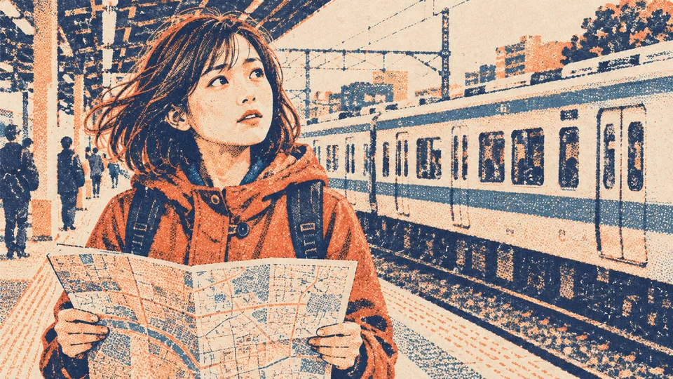

A stencil printing process with a small ink palette, textured solids, and imperfect color registration.

Copy this section by itself after your own subject description. It intentionally does not describe the gallery character or train platform.

```text
Render the subject as a two-color risograph print on warm off-white uncoated paper. Use only deep midnight-navy and warm coral-orange spot inks, plus the third dark tone formed where they overlap; let the paper supply the light areas. Reduce the image to bold graphic shapes and strong contours. If a person appears, keep their expression readable through simplified comic-like features. Build midtones from coarse halftone dots and irregular ink grain, with slight visible misregistration between the two plates and imperfect ink coverage. Avoid full-color gradients, clean vector flatness, photographic shading, and uniform digital-noise overlays.
```

**Watch for:** A uniform digital noise overlay is not a substitute for uneven ink and interacting color layers.
**Cover layout:** For a portrait cover, request separate space for the title. Typeset the lettering afterward.

### Gouache

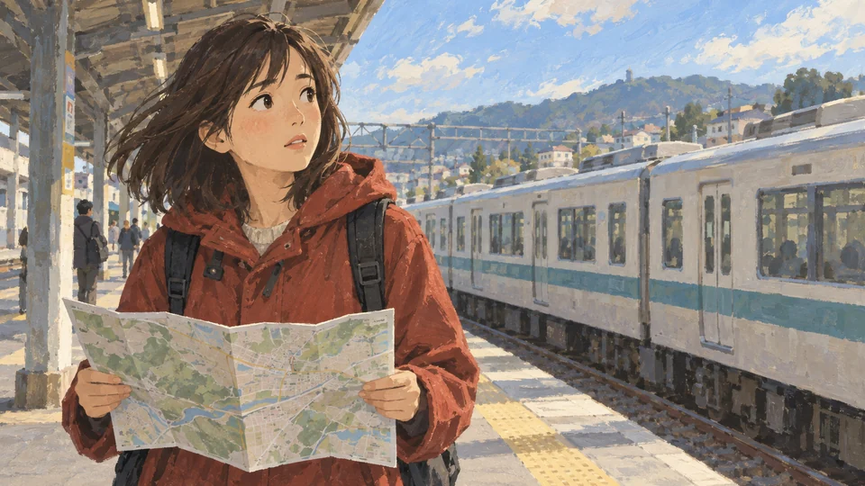

Opaque, matte color creates confident shapes with hand-painted transitions and softly visible brushwork.

Copy this section by itself after your own subject description. It intentionally does not describe the gallery character or train platform.

```text
Render the subject as an opaque gouache illustration with the warmth of hand-painted Japanese animation background art. Use broad, confident matte color shapes, layered opaque paint, softly visible bristle marks, and edges shaped by the brush rather than heavy ink outlines. If a person appears, give them simplified expressive drawn features. Balance muted powder blues, warm stone neutrals, and one earthy red accent; let soft daylight separate foreground and distance. Preserve enough surface texture to feel painted on paper. Avoid transparent watercolor blooms, glossy acrylic shine, photorealistic skin, and perfectly smooth vector fills.
```

**Watch for:** Excess shine or transparent washes can make the image look like acrylic or watercolor instead.
**Cover layout:** For a portrait cover, request separate space for the title. Typeset the lettering afterward.

### Ink Wash

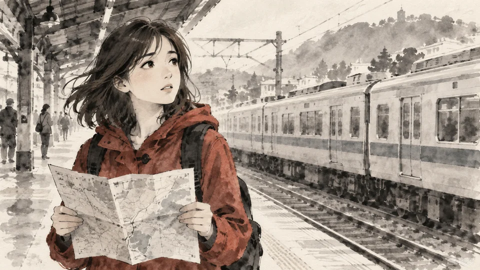

Diluted ink describes form through value, gesture, and the balance between marks and untouched paper.

Copy this section by itself after your own subject description. It intentionally does not describe the gallery character or train platform.

```text
Render the subject as an expressive ink-wash illustration on absorbent off-white paper. Build almost the entire image from black ink diluted into soft gray tonal washes, reserved white paper, and a few energetic dark calligraphic marks. When a person appears, use delicate manga-inspired contour lines around the face and hands, with simplified expressive features. Permit a single muted rust-red accent on the main subject; reinterpret every other color specified in the subject description as grayscale, including clothing and background details. Let distant forms dissolve into wet washes while focal details remain legible. Avoid photographic grayscale, full-color watercolor, polished digital gradients, and uniformly heavy outlines.
```

**Watch for:** Pure grayscale with photographic shading misses the expressive role of brush marks and open paper.
**Cover layout:** For a portrait cover, request separate space for the title. Typeset the lettering afterward.

### Pixel Art

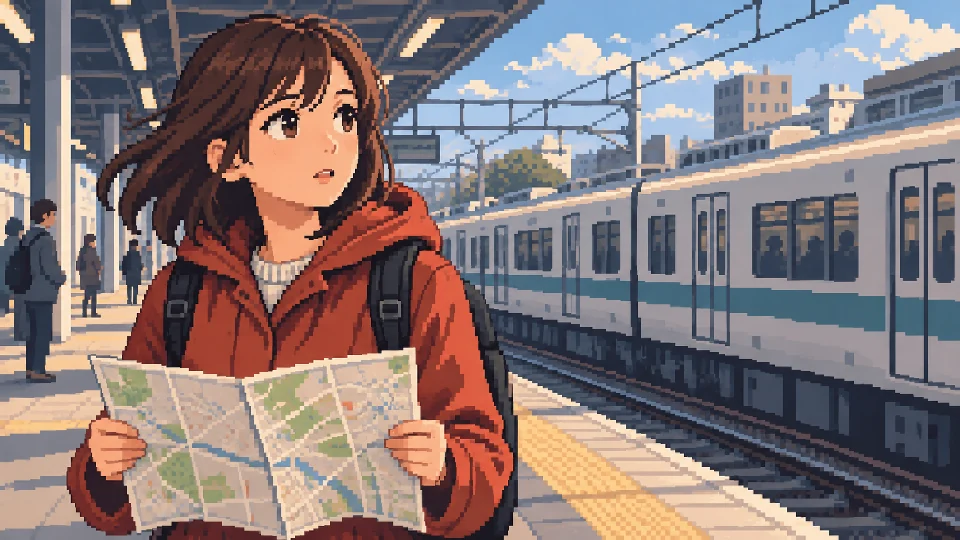

Shapes are deliberately designed on a small pixel grid, using clusters of flat color rather than smooth gradients.

Copy this section by itself after your own subject description. It intentionally does not describe the gallery character or train platform.

```text
Render the subject as carefully authored 2D pixel art for a narrative adventure game. Design on a low-resolution pixel grid, roughly 320 by 180 logical pixels for a wide scene, then display it with crisp nearest-neighbor enlargement. Use a limited palette of navy, slate blue, warm cream, peach, and rust red. Build forms from intentional square pixel clusters, stepped contours, flat color bands, and discrete shade changes; use readable anime-inspired sprite features if people appear. Keep the background architecture legible without fine photographic detail. Avoid blur, antialiasing, smooth gradients, vector outlines, and a merely downsampled photograph.
```

**Watch for:** A blurry low-resolution picture is not pixel art; every cluster should look intentional.
**Cover layout:** For a portrait cover, request separate space for the title. Typeset the lettering afterward.

### 35mm Film


A photographic look shaped by organic grain, gentle highlight rolloff, and slightly imperfect color response.

Copy this section by itself after your own subject description. It intentionally does not describe the gallery character or train platform.

```text
Render the subject as a candid photograph on 35mm color negative film, not an illustration. Use a natural 50mm documentary viewpoint, available light, gentle backlight when the scene permits, soft highlight rolloff, muted warm highlights, and slightly cool teal shadows. Keep the primary subject in believable focus while the background softens naturally through lens depth of field. If a person appears, preserve natural anatomy and an unposed expression. Add fine organic grain and slight exposure variation in the image itself, without making it look like a digital noise filter. Favor an observed everyday moment over polished commercial staging. Avoid airbrushed skin, heavy cinematic color grading, extreme bokeh, and painterly or anime rendering.
```

**Watch for:** An aggressive grain overlay alone will not create believable lens, light, and color behavior.
**Cover layout:** For a portrait cover, request separate space for the title. Typeset the lettering afterward.

### Flat Japanese Anime

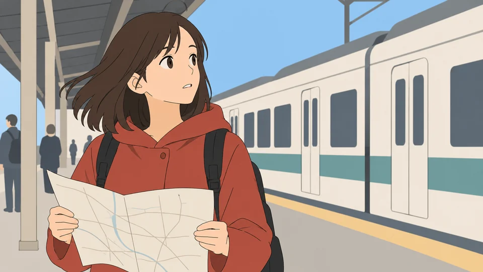

Light, clear illustration built from silhouettes and flat color.

Copy this section by itself after your own subject description. It intentionally does not describe the gallery character or train platform.

```text
Render the supplied subject and scene in the following visual style. Use fine, even outlines around closed shapes and no more than eight flat colors across the image. Do not add shadow colors, highlights, or gradients to any material. Treat hair and clothing, when present, as single color shapes. Simplify objects to a silhouette and a few identifying lines. Reduce the background to its essential shapes, omitting reflections, cast shadows, and distant small details. Show depth only through overlaps. When people appear, use concise Japanese anime features and natural proportions. Leave areas deliberately undescribed, as in a flat hand-drawn illustration. Follow the separate subject-and-scene description for people, clothing, objects, and setting; do not add them from this style instruction. Do not render text, logos, or watermarks. Avoid gradients, modeled skin, and intricate backgrounds.
```

**Watch for:** Avoid gradients, modeled skin, and intricate backgrounds; these can obscure the technique.
**Cover layout:** For a portrait cover, keep the upper 25% low in detail and place the subject and any face below the center. Typeset the title and author name afterward.

### Two-Tone Cel Shading

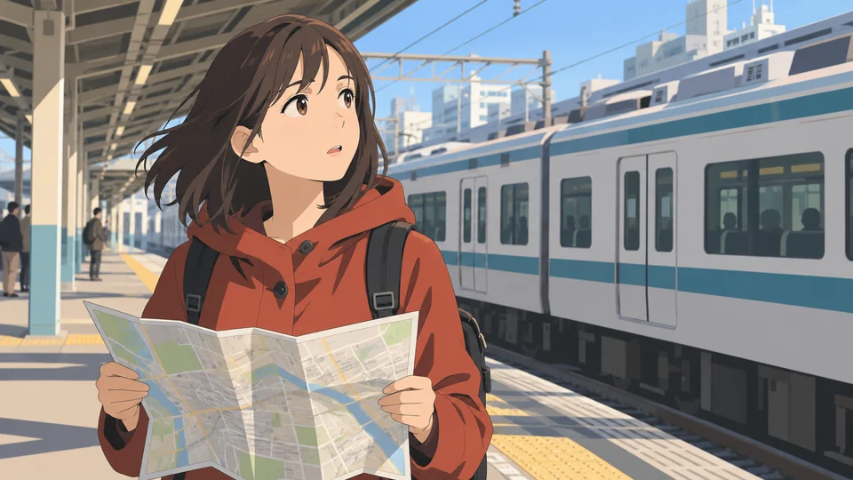

Readable characters with the crisp shadow shapes of TV animation.

Copy this section by itself after your own subject description. It intentionally does not describe the gallery character or train platform.

```text
Render the supplied subject and scene in the following visual style. Paint each material using its base color and a single shadow color. Keep shadow boundaries hard and the light direction consistent. When people appear, simplify the face and hands in a Japanese anime drawing language, with small, clearly organized shadows. Follow the separate subject-and-scene description for people, clothing, objects, and setting; do not add them from this style instruction. Do not render text, logos, or watermarks. Avoid airbrushed blur and multiple layers of reflected light.
```

**Watch for:** Avoid airbrushed blur and multiple layers of reflected light; these can obscure the technique.
**Cover layout:** For a portrait cover, keep the upper 25% low in detail and place the subject and any face below the center. Typeset the title and author name afterward.

### Lineless Anime

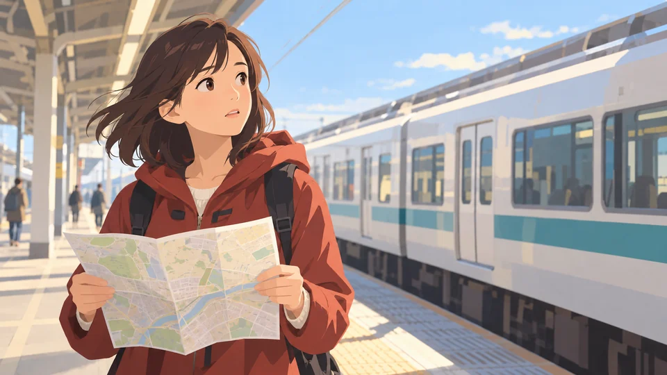

Gentle silhouettes defined by neighboring color shapes instead of ink outlines. Selective detail leaves intentional breathing room.

Copy this section by itself after your own subject description. It intentionally does not describe the gallery character or train platform.

```text
Render the supplied subject and scene in the following visual style. Omit exterior contour lines and define boundaries with adjacent color shapes and value differences. Keep only a few fine internal lines for essential features such as eyes and noses. Use simplified anime forms, dividing hair and clothing into broad shapes when present. Follow the separate subject-and-scene description for people, clothing, objects, and setting; do not add them from this style instruction. Do not render text, logos, or watermarks. Avoid black edging and photorealistic shading. Do not distribute detail evenly. Finish the focal shape and expression carefully, then use technique-appropriate omissions elsewhere: broken contours, fewer shadows, or untouched paper and ground color. Do not add background objects or ornaments. Give empty areas a deliberate compositional role; do not substitute low resolution or all-over blur.
```

**Watch for:** Avoid black edging and photorealistic shading; these can obscure the technique.
**Cover layout:** For a portrait cover, keep the upper 25% low in detail and place the subject and any face below the center. Typeset the title and author name afterward.

### Bold-Line Pop Anime

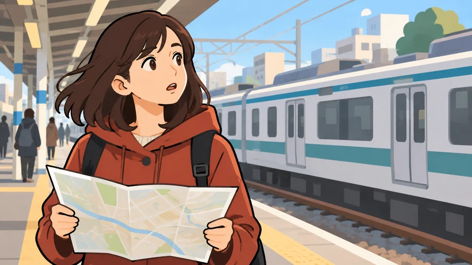

Energetic silhouettes that stay readable at small cover sizes.

Copy this section by itself after your own subject description. It intentionally does not describe the gallery character or train platform.

```text
Render the supplied subject and scene in the following visual style. Enclose silhouettes with thick outlines and rounded line endings; use fewer interior lines. Paint broad color fields with a single shadow step. Make expressions clear when people appear and organize the background into simple geometric shapes. Follow the separate subject-and-scene description for people, clothing, objects, and setting; do not add them from this style instruction. Do not render text, logos, or watermarks. Avoid crowded fine lines and photographic surfaces.
```

**Watch for:** Avoid crowded fine lines and photographic surfaces; these can obscure the technique.
**Cover layout:** For a portrait cover, keep the upper 25% low in detail and place the subject and any face below the center. Typeset the title and author name afterward.

### Hand-Painted Retro Cel

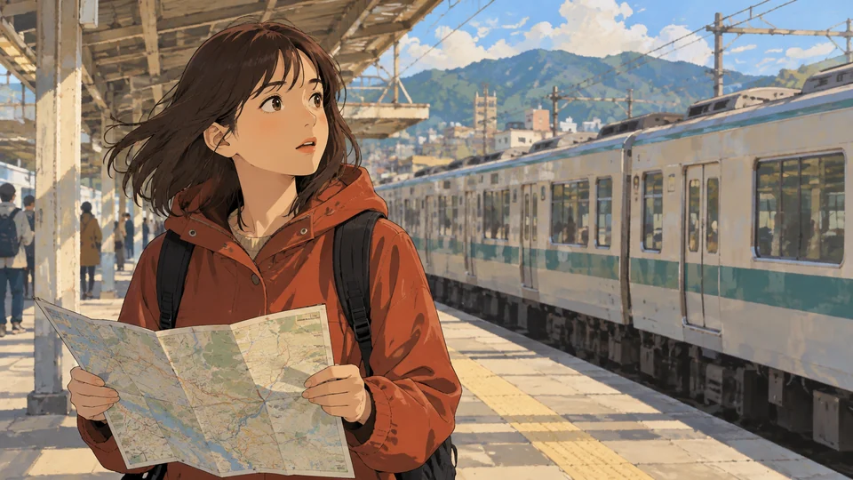

A nostalgic balance of hand-inked characters and painted backgrounds.

Copy this section by itself after your own subject description. It intentionally does not describe the gallery character or train platform.

```text
Render the supplied subject and scene in the following visual style. Retain small changes in hand-drawn line width. Use opaque cel-style flat fills and hard shadows, paired with softer poster-paint brushwork in the background. Leave faint irregularities in the painted surface. Follow the separate subject-and-scene description for people, clothing, objects, and setting; do not add them from this style instruction. Do not render text, logos, or watermarks. Avoid large VHS scan lines and noise-filter imitations.
```

**Watch for:** Avoid large VHS scan lines and noise-filter imitations; these can obscure the technique.
**Cover layout:** For a portrait cover, keep the upper 25% low in detail and place the subject and any face below the center. Typeset the title and author name afterward.

### Manga Screentone

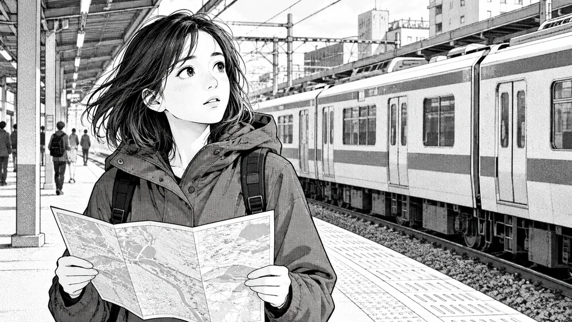

A story moment rendered with black ink, white space, and structured screen tones.

Copy this section by itself after your own subject description. It intentionally does not describe the gallery character or train platform.

```text
Render the supplied subject and scene in the following visual style. Use black ink and white paper only. Vary the pen pressure around contours and build shadows with regular screentone dots and solid black shapes. Preserve more white around the focal face and hands when people appear. Follow the separate subject-and-scene description for people, clothing, objects, and setting; do not add them from this style instruction. Do not render text, logos, or watermarks. Avoid continuous photographic grayscale and uniform grain.
```

**Watch for:** Avoid continuous photographic grayscale and uniform grain; these can obscure the technique.
**Cover layout:** For a portrait cover, keep the upper 25% low in detail and place the subject and any face below the center. Typeset the title and author name afterward.

### Delicate Shojo Linework

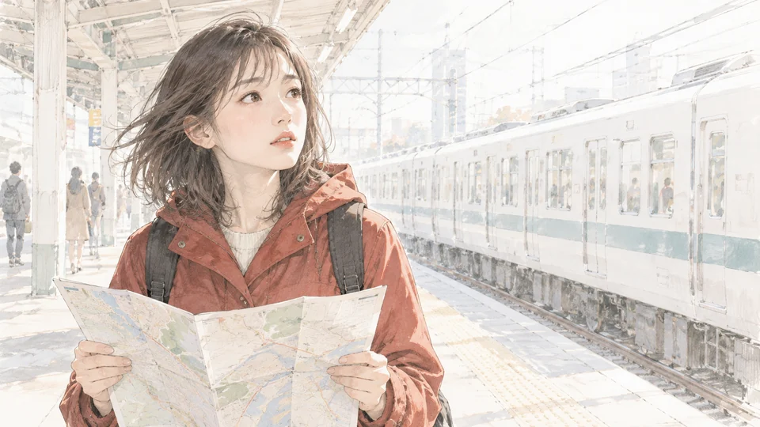

Lyrical drawing that gives attention to flowing hair and a quiet gaze. Selective detail leaves intentional breathing room.

Copy this section by itself after your own subject description. It intentionally does not describe the gallery character or train platform.

```text
Render the supplied subject and scene in the following visual style. Draw flowing forms with extremely fine tapered lines, concentrating line density near the focal features. Keep color in pale transparent layers and partially omit background contours. When people appear, emphasize delicate hair and eye lines; use the same fine linework and open white space for other subjects. Follow the separate subject-and-scene description for people, clothing, objects, and setting; do not add them from this style instruction. Do not render text, logos, or watermarks. Avoid mandatory flowers or stars, excessive eyelashes, and heavy shadows. Do not distribute detail evenly. Finish the focal shape and expression carefully, then use technique-appropriate omissions elsewhere: broken contours, fewer shadows, or untouched paper and ground color. Do not add background objects or ornaments. Give empty areas a deliberate compositional role; do not substitute low resolution or all-over blur.
```

**Watch for:** Avoid mandatory flowers or stars, excessive eyelashes, and heavy shadows; these can obscure the technique.
**Cover layout:** For a portrait cover, keep the upper 25% low in detail and place the subject and any face below the center. Typeset the title and author name afterward.

### Playful Chibi Illustration

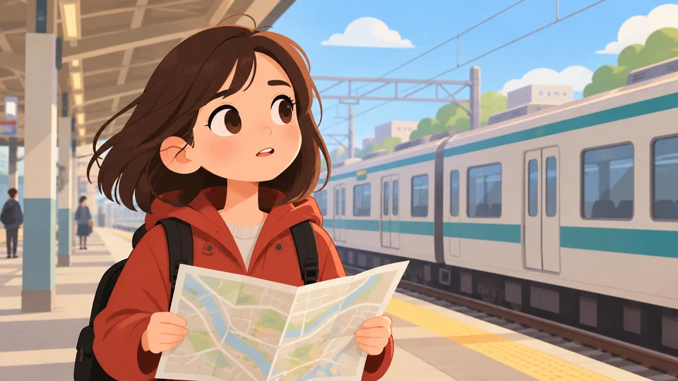

Friendly, comic illustration for playful stories and short fiction.

Copy this section by itself after your own subject description. It intentionally does not describe the gallery character or train platform.

```text
Render the supplied subject and scene in the following visual style. When people appear, use a larger head and short limbs with roughly three- to four-head-tall proportions. Simplify objects and backgrounds into rounded shapes too. Use two or three flat shade steps, keeping expressions and actions easy to read. Follow the separate subject-and-scene description for people, clothing, objects, and setting; do not add them from this style instruction. Do not render text, logos, or watermarks. Avoid realistic proportions, detailed muscles, and excessive ornament.
```

**Watch for:** Avoid realistic proportions, detailed muscles, and excessive ornament; these can obscure the technique.
**Cover layout:** For a portrait cover, keep the upper 25% low in detail and place the subject and any face below the center. Typeset the title and author name afterward.

### Anime Pencil Rough

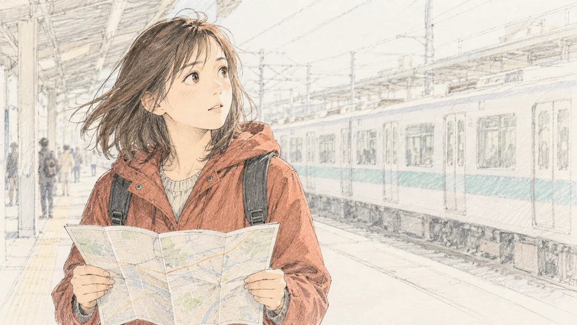

Drawing that preserves the liveliness of an animation rough rather than a polished finish. Selective detail leaves intentional breathing room.

Copy this section by itself after your own subject description. It intentionally does not describe the gallery character or train platform.

```text
Render the supplied subject and scene in the following visual style. Use animation-layout pencil contours, faint exploratory redrawn lines, and short hatching. Darken important edges while leaving the background pale. Keep light color fields to a minimum and expose plenty of bare paper. Follow the separate subject-and-scene description for people, clothing, objects, and setting; do not add them from this style instruction. Do not render text, logos, or watermarks. Avoid production notes or color codes and polished cel surfaces. Do not distribute detail evenly. Finish the focal shape and expression carefully, then use technique-appropriate omissions elsewhere: broken contours, fewer shadows, or untouched paper and ground color. Do not add background objects or ornaments. Give empty areas a deliberate compositional role; do not substitute low resolution or all-over blur.
```

**Watch for:** Avoid production notes or color codes and polished cel surfaces; these can obscure the technique.
**Cover layout:** For a portrait cover, keep the upper 25% low in detail and place the subject and any face below the center. Typeset the title and author name afterward.

### Painted Anime Background

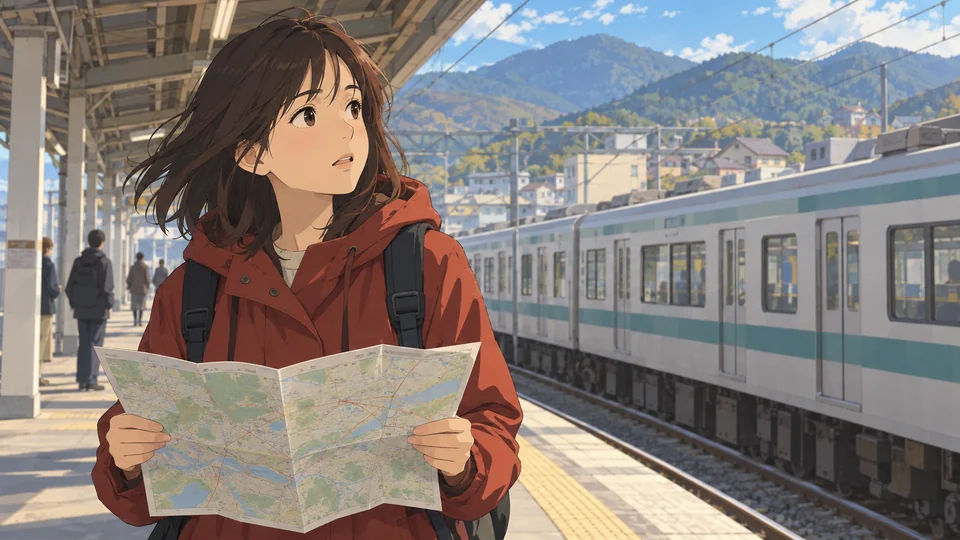

Atmospheric setting-led illustration with a clear sense of distance.

Copy this section by itself after your own subject description. It intentionally does not describe the gallery character or train platform.

```text
Render the supplied subject and scene in the following visual style. Paint architecture and nature with fine opaque brushwork in the language of Japanese animation backgrounds. Keep the foreground clear and lower value contrast and saturation in the distance. If people appear, distinguish them from the setting with simple cel shading. Follow the separate subject-and-scene description for people, clothing, objects, and setting; do not add them from this style instruction. Do not render text, logos, or watermarks. Avoid pasted photographs and equal detail everywhere.
```

**Watch for:** Avoid pasted photographs and equal detail everywhere; these can obscure the technique.
**Cover layout:** For a portrait cover, keep the upper 25% low in detail and place the subject and any face below the center. Typeset the title and author name afterward.

### Light Novel: Clear Color

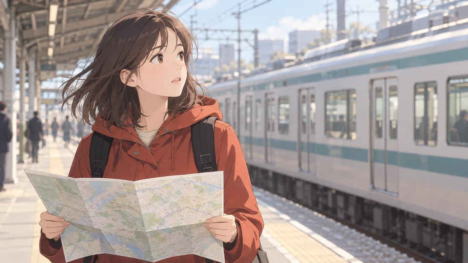

Clean, readable character illustration with restrained luminous color.

Copy this section by itself after your own subject description. It intentionally does not describe the gallery character or train platform.

```text
Render the supplied subject and scene in the following visual style. Use precise fine lines and Japanese anime forms. Keep skin shading light when people appear and build transparent light and dark layers along groups of hair. Limit small reflected highlights to the focal area and simplify the background to low-contrast shapes. Follow the separate subject-and-scene description for people, clothing, objects, and setting; do not add them from this style instruction. Do not render text, logos, or watermarks. Avoid strong gloss everywhere and photographic skin.
```

**Watch for:** Avoid strong gloss everywhere and photographic skin; these can obscure the technique.
**Cover layout:** For a portrait cover, keep the upper 25% low in detail and place the subject and any face below the center. Typeset the title and author name afterward.

### Light Novel: Soft Romance


Soft emotional distance for romance and coming-of-age stories. Selective detail leaves intentional breathing room.

Copy this section by itself after your own subject description. It intentionally does not describe the gallery character or train platform.

```text
Render the supplied subject and scene in the following visual style. Draw fine contours close to each local color and let soft backlight brighten or lose selected edges. Use anime forms and pale gradients, with shallow facial shadows when people appear. Simplify everything away from the focal area into large gentle shapes. Follow the separate subject-and-scene description for people, clothing, objects, and setting; do not add them from this style instruction. Do not render text, logos, or watermarks. Avoid mandatory petals or hearts and excessive bokeh circles. Do not distribute detail evenly. Finish the focal shape and expression carefully, then use technique-appropriate omissions elsewhere: broken contours, fewer shadows, or untouched paper and ground color. Do not add background objects or ornaments. Give empty areas a deliberate compositional role; do not substitute low resolution or all-over blur.
```

**Watch for:** Avoid mandatory petals or hearts and excessive bokeh circles; these can obscure the technique.
**Cover layout:** For a portrait cover, keep the upper 25% low in detail and place the subject and any face below the center. Typeset the title and author name afterward.

### Light Novel: Angular Action

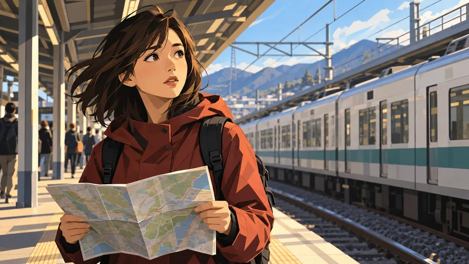

Tension expressed through sharp edges, directional shapes, and strong value groups.

Copy this section by itself after your own subject description. It intentionally does not describe the gallery character or train platform.

```text
Render the supplied subject and scene in the following visual style. Give contours sharp corners and varied weight. Organize fabric and hair into directional shapes when present. Divide light and dark into large groups and concentrate contrast at the focal area. Preserve the supplied scene while using diagonal rhythms to create tension. Follow the separate subject-and-scene description for people, clothing, objects, and setting; do not add them from this style instruction. Do not render text, logos, or watermarks. Avoid unrequested weapons or explosions and meaningless speed lines.
```

**Watch for:** Avoid unrequested weapons or explosions and meaningless speed lines; these can obscure the technique.
**Cover layout:** For a portrait cover, keep the upper 25% low in detail and place the subject and any face below the center. Typeset the title and author name afterward.

### Light Novel: Painterly Fantasy

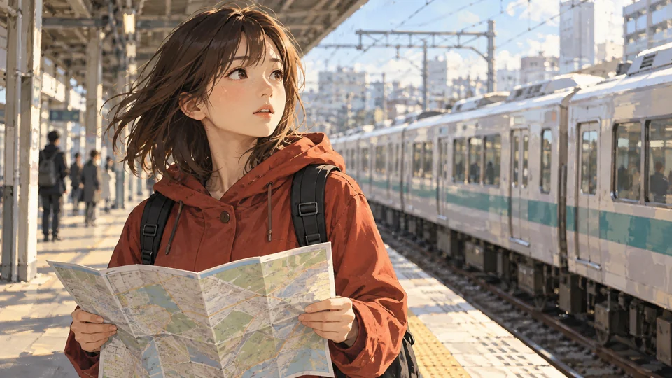

Painterly depth and material variation suited to imaginative fiction.

Copy this section by itself after your own subject description. It intentionally does not describe the gallery character or train platform.

```text
Render the supplied subject and scene in the following visual style. Retain anime-influenced character forms when people appear, while modeling clothing and the setting with thin layers of opaque brushwork. Vary reflection and brush marks by material, concentrating detail at the focal area. Group the background into broad light and dark masses. Follow the separate subject-and-scene description for people, clothing, objects, and setting; do not add them from this style instruction. Do not render text, logos, or watermarks. Avoid unrequested magic circles, gems, or costume changes.
```

**Watch for:** Avoid unrequested magic circles, gems, or costume changes; these can obscure the technique.
**Cover layout:** For a portrait cover, keep the upper 25% low in detail and place the subject and any face below the center. Typeset the title and author name afterward.

### Light Novel: Quiet Mystery

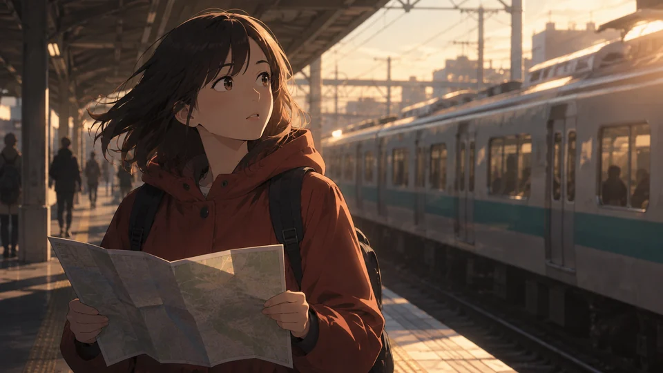

A dark, restrained illustration that keeps its focal point readable.

Copy this section by itself after your own subject description. It intentionally does not describe the gallery character or train platform.

```text
Render the supplied subject and scene in the following visual style. Use Japanese anime forms with a large shadow group covering roughly half the image. Clarify only the focal contours and let other edges merge into darkness. Use a small local light source and low-saturation color to create quiet tension. Follow the separate subject-and-scene description for people, clothing, objects, and setting; do not add them from this style instruction. Do not render text, logos, or watermarks. Avoid added blood or horror objects and crushed detail everywhere.
```

**Watch for:** Avoid added blood or horror objects and crushed detail everywhere; these can obscure the technique.
**Cover layout:** For a portrait cover, keep the upper 25% low in detail and place the subject and any face below the center. Typeset the title and author name afterward.

### Light Novel: Precise SF

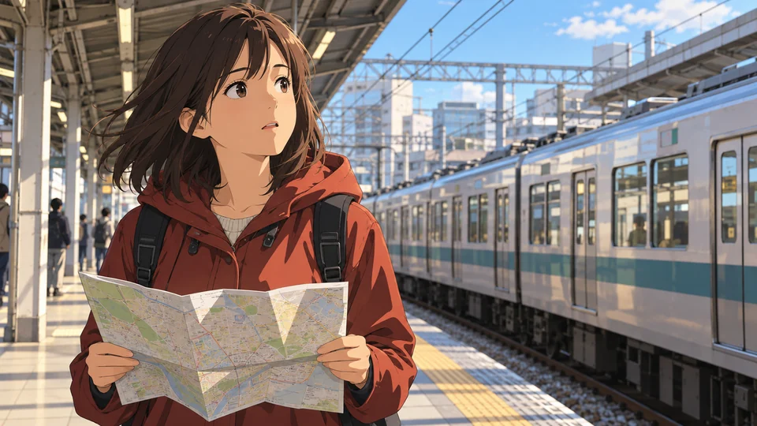

An analytical image that distinguishes structure and material without visual clutter.

Copy this section by itself after your own subject description. It intentionally does not describe the gallery character or train platform.

```text
Render the supplied subject and scene in the following visual style. Draw forms with fine precise anime linework and distinguish reflections on metal, glass, and cloth when those materials are specified. Base shading on hard planes and keep reflected highlights small. Clarify straight structural lines in the background while preserving gentle character expressions. Follow the separate subject-and-scene description for people, clothing, objects, and setting; do not add them from this style instruction. Do not render text, logos, or watermarks. Avoid unrequested machinery or HUD overlays and neon everywhere.
```

**Watch for:** Avoid unrequested machinery or HUD overlays and neon everywhere; these can obscure the technique.
**Cover layout:** For a portrait cover, keep the upper 25% low in detail and place the subject and any face below the center. Typeset the title and author name afterward.

### Light Novel: Brush Ink Color

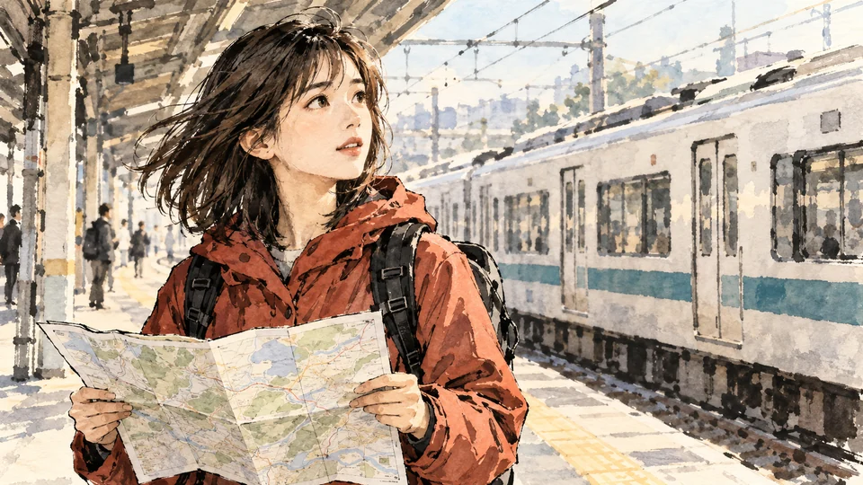

Expressive ink contours with light color for folklore or literary fantasy.

Copy this section by itself after your own subject description. It intentionally does not describe the gallery character or train platform.

```text
Render the supplied subject and scene in the following visual style. Make the speed and pressure of brush-pen contours the main visual language. Fill interiors with pale color layers and form shadows through line density and a few ink shapes. Concentrate black at the focal area and retain occasional dry-brush breaks. Follow the separate subject-and-scene description for people, clothing, objects, and setting; do not add them from this style instruction. Do not render text, logos, or watermarks. Avoid an all-over ink wash and mandatory traditional clothing or blossoms.
```

**Watch for:** Avoid an all-over ink wash and mandatory traditional clothing or blossoms; these can obscure the technique.
**Cover layout:** For a portrait cover, keep the upper 25% low in detail and place the subject and any face below the center. Typeset the title and author name afterward.

### Light Novel: Pastel Everyday

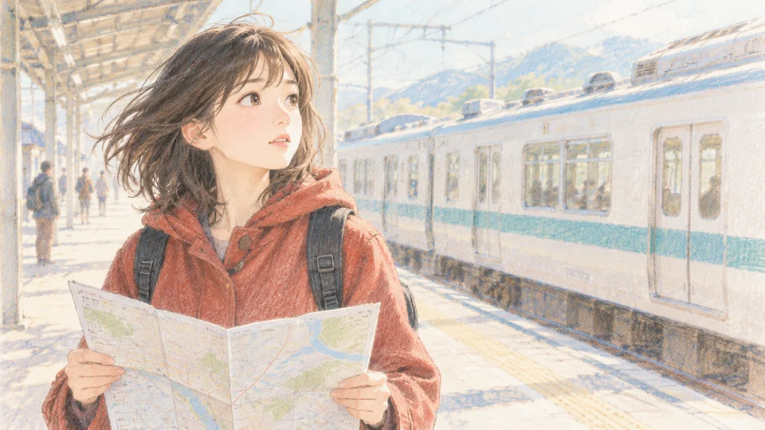

Warm everyday scenes with a soft, tactile, powder-on-paper finish. Selective detail leaves intentional breathing room.

Copy this section by itself after your own subject description. It intentionally does not describe the gallery character or train platform.

```text
Render the supplied subject and scene in the following visual style. Use calm anime forms when people appear and soft contours resembling colored pencil. Apply color as fine pastel powder on paper, lightly rubbing boundaries between overlapping layers. Keep shadows shallow and leave plenty of white visible. Follow the separate subject-and-scene description for people, clothing, objects, and setting; do not add them from this style instruction. Do not render text, logos, or watermarks. Avoid photorealistic pastel portraits and strong black outlines. Do not distribute detail evenly. Finish the focal shape and expression carefully, then use technique-appropriate omissions elsewhere: broken contours, fewer shadows, or untouched paper and ground color. Do not add background objects or ornaments. Give empty areas a deliberate compositional role; do not substitute low resolution or all-over blur.
```

**Watch for:** Avoid photorealistic pastel portraits and strong black outlines; these can obscure the technique.
**Cover layout:** For a portrait cover, keep the upper 25% low in detail and place the subject and any face below the center. Typeset the title and author name afterward.

### Light Novel: Focused Brilliance

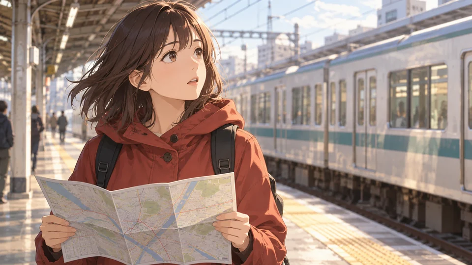

Controlled highlights bring a focal point to life without making every surface glossy.

Copy this section by itself after your own subject description. It intentionally does not describe the gallery character or train platform.

```text
Render the supplied subject and scene in the following visual style. Use fine anime outlines and transparent color layers. Place small sharp highlights in hair, eyes, or specified hard materials when present; keep soft materials matte. Concentrate reflected light at the focal point. Follow the separate subject-and-scene description for people, clothing, objects, and setting; do not add them from this style instruction. Do not render text, logos, or watermarks. Avoid added gems, plastic gloss over the whole subject, and oversaturation.
```

**Watch for:** Avoid added gems, plastic gloss over the whole subject, and oversaturation; these can obscure the technique.
**Cover layout:** For a portrait cover, keep the upper 25% low in detail and place the subject and any face below the center. Typeset the title and author name afterward.

### Light Novel: Graphic Cover

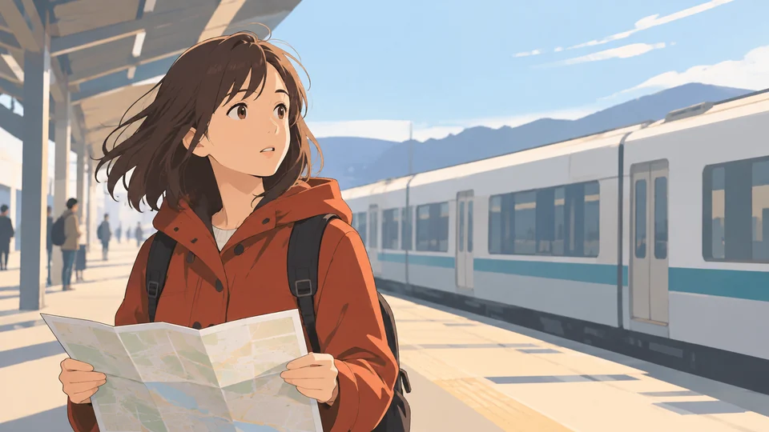

Character and geometric rhythms arranged to leave room for a title. Selective detail leaves intentional breathing room.

Copy this section by itself after your own subject description. It intentionally does not describe the gallery character or train platform.

```text
Render the supplied subject and scene in the following visual style. Render the main subject with clear anime contours and two or three shade steps. Reduce concrete background objects to their necessary shapes and compose with broad planes and diagonal rhythms. Leave low-detail space around the focal area. Follow the separate subject-and-scene description for people, clothing, objects, and setting; do not add them from this style instruction. Do not render text, logos, or watermarks. Avoid generated lettering and crowded decorative shapes. Do not distribute detail evenly. Finish the focal shape and expression carefully, then use technique-appropriate omissions elsewhere: broken contours, fewer shadows, or untouched paper and ground color. Do not add background objects or ornaments. Give empty areas a deliberate compositional role; do not substitute low resolution or all-over blur.
```

**Watch for:** Avoid generated lettering and crowded decorative shapes; these can obscure the technique.
**Cover layout:** For a portrait cover, keep the upper 25% low in detail and place the subject and any face below the center. Typeset the title and author name afterward.

### Literary: Open Line Drawing

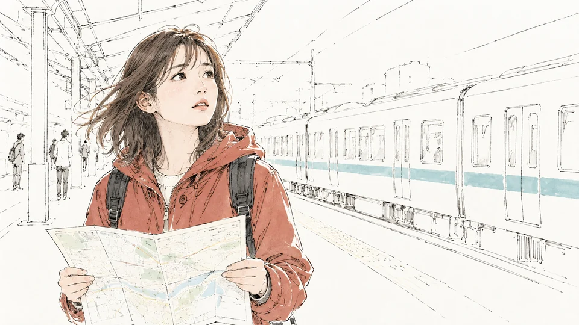

Quiet presence expressed through a few considered lines and open paper. Selective detail leaves intentional breathing room.

Copy this section by itself after your own subject description. It intentionally does not describe the gallery character or train platform.

```text
Render the supplied subject and scene in the following visual style. Draw only the identifying features of the subject with a few fine ink lines. Break contours in selected places and restrict shading to very few short strokes. Keep only essential background edges and use broad bare-paper areas to create breathing room. Follow the separate subject-and-scene description for people, clothing, objects, and setting; do not add them from this style instruction. Do not render text, logos, or watermarks. Avoid dense all-over hatching and enormous solid-black areas. Do not distribute detail evenly. Finish the focal shape and expression carefully, then use technique-appropriate omissions elsewhere: broken contours, fewer shadows, or untouched paper and ground color. Do not add background objects or ornaments. Give empty areas a deliberate compositional role; do not substitute low resolution or all-over blur.
```

**Watch for:** Avoid dense all-over hatching and enormous solid-black areas; these can obscure the technique.
**Cover layout:** For a portrait cover, keep the upper 25% low in detail and place the subject and any face below the center. Typeset the title and author name afterward.

### Literary: Graphite Sketch

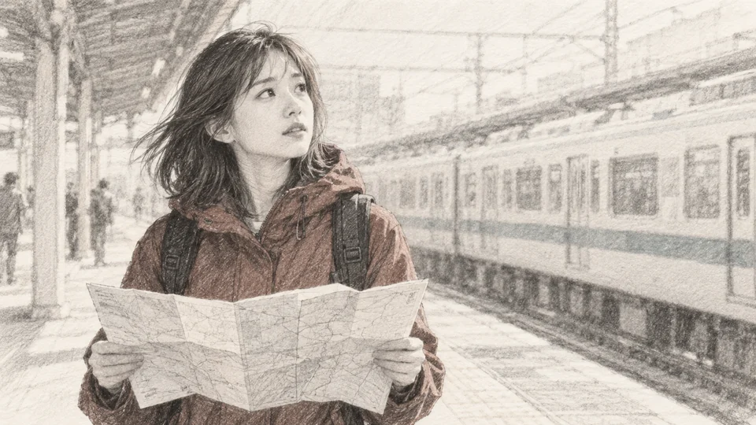

Tactile pencil values that suggest memory without finishing every edge. Selective detail leaves intentional breathing room.

Copy this section by itself after your own subject description. It intentionally does not describe the gallery character or train platform.

```text
Render the supplied subject and scene in the following visual style. Draw with graphite pencil only. Use fine contours, short hatching, and lightly rubbed gray to model forms. Build up lines at the focal point and leave the background faint, as if still being sketched. Preserve uneven graphite catching on the paper tooth. Follow the separate subject-and-scene description for people, clothing, objects, and setting; do not add them from this style instruction. Do not render text, logos, or watermarks. Avoid black-and-white photo conversion and perfectly smooth tonal gradients. Do not distribute detail evenly. Finish the focal shape and expression carefully, then use technique-appropriate omissions elsewhere: broken contours, fewer shadows, or untouched paper and ground color. Do not add background objects or ornaments. Give empty areas a deliberate compositional role; do not substitute low resolution or all-over blur.
```

**Watch for:** Avoid black-and-white photo conversion and perfectly smooth tonal gradients; these can obscure the technique.
**Cover layout:** For a portrait cover, keep the upper 25% low in detail and place the subject and any face below the center. Typeset the title and author name afterward.

### Literary: Copperplate Etching

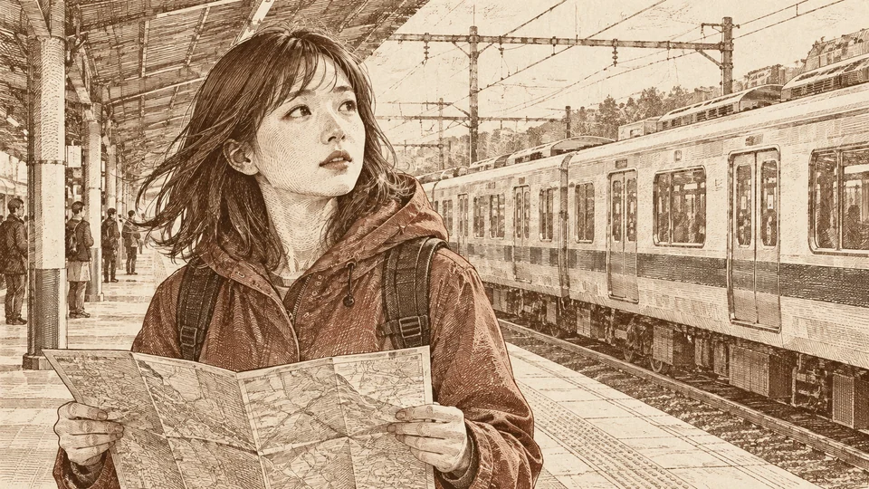

Dense engraved linework and open paper create weight and a sense of time.

Copy this section by itself after your own subject description. It intentionally does not describe the gallery character or train platform.

```text
Render the supplied subject and scene in the following visual style. Render as a single-ink copperplate etching. Describe forms with fine engraved lines and crosshatching, following the direction of surfaces rather than merely outlining them. Build darkness with line density and preserve the paper ground with faint ink left from wiping. Follow the separate subject-and-scene description for people, clothing, objects, and setting; do not add them from this style instruction. Do not render text, logos, or watermarks. Avoid screentone dots, photographic values, and ornamental plate borders.
```

**Watch for:** Avoid screentone dots, photographic values, and ornamental plate borders; these can obscure the technique.
**Cover layout:** For a portrait cover, keep the upper 25% low in detail and place the subject and any face below the center. Typeset the title and author name afterward.

### Literary: Carved Woodcut

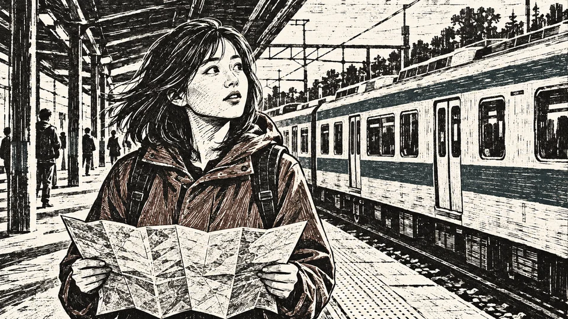

Forceful shapes and rough cuts support stories with gravity and directness.

Copy this section by itself after your own subject description. It intentionally does not describe the gallery character or train platform.

```text
Render the supplied subject and scene in the following visual style. Render as a single-ink woodcut, combining white carved lines with black printing areas. Run short cut marks in the direction of forms and compose with broad black-and-white masses. Keep wood grain and ink breaks in selected areas. Follow the separate subject-and-scene description for people, clothing, objects, and setting; do not add them from this style instruction. Do not render text, logos, or watermarks. Avoid smooth vector shapes and fine copperplate crosshatching.
```

**Watch for:** Avoid smooth vector shapes and fine copperplate crosshatching; these can obscure the technique.
**Cover layout:** For a portrait cover, keep the upper 25% low in detail and place the subject and any face below the center. Typeset the title and author name afterward.

### Literary: Linocut

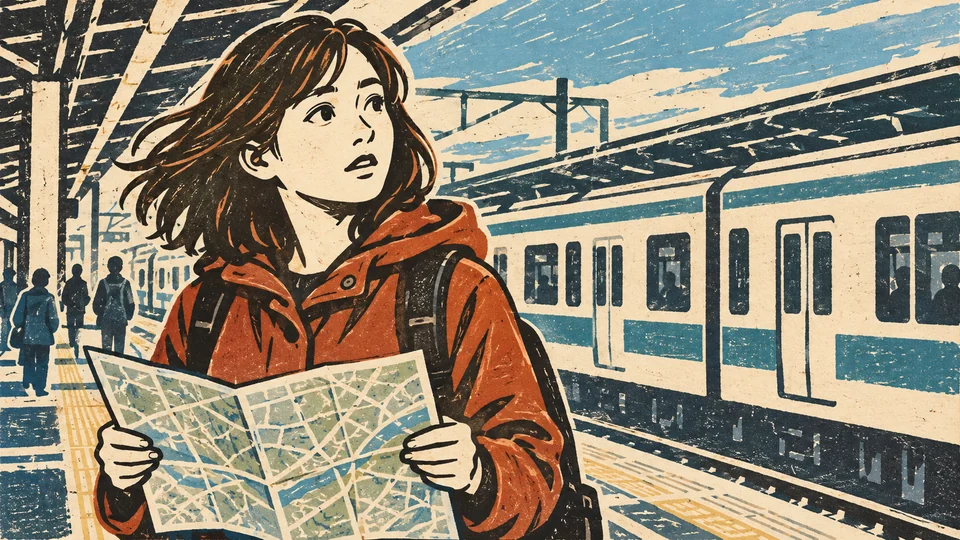

Simpler shapes and curved cuts offer a smoother alternative to woodcut.

Copy this section by itself after your own subject description. It intentionally does not describe the gallery character or train platform.

```text
Render the supplied subject and scene in the following visual style. Render with the rounded, flowing cut marks of a linoleum print. Organize contours into broad cut lines and overlap two or three color plates. Build shading through repeated curves and large planes, retaining slight unevenness in the ink. Follow the separate subject-and-scene description for people, clothing, objects, and setting; do not add them from this style instruction. Do not render text, logos, or watermarks. Avoid wood grain, dotted screen tones, and photographic shading.
```

**Watch for:** Avoid wood grain, dotted screen tones, and photographic shading; these can obscure the technique.
**Cover layout:** For a portrait cover, keep the upper 25% low in detail and place the subject and any face below the center. Typeset the title and author name afterward.

### Literary: Wiped Monotype

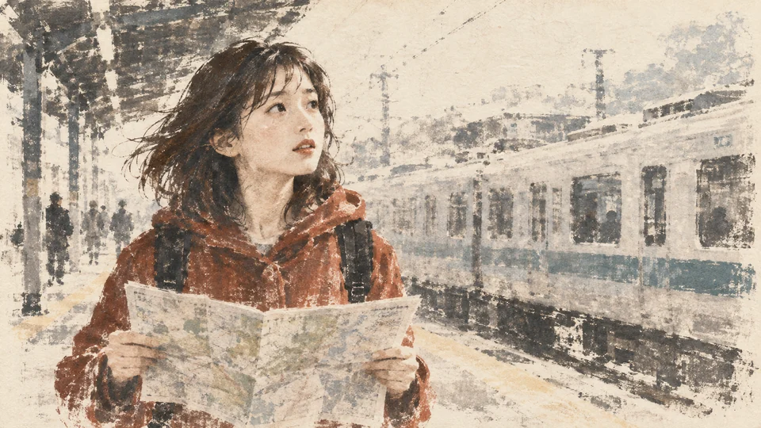

Soft transferred traces suggest an incomplete or uncertain memory. Selective detail leaves intentional breathing room.

Copy this section by itself after your own subject description. It intentionally does not describe the gallery character or train platform.

```text
Render the supplied subject and scene in the following visual style. Render as a one-off monotype, building forms from ink wiped on a plate and soft transferred edges. Keep the main subject readable while allowing the background to dissolve into rubbed marks and thin ink films. Follow the separate subject-and-scene description for people, clothing, objects, and setting; do not add them from this style instruction. Do not render text, logos, or watermarks. Avoid bright watercolor blooms and regular halftone dots. Do not distribute detail evenly. Finish the focal shape and expression carefully, then use technique-appropriate omissions elsewhere: broken contours, fewer shadows, or untouched paper and ground color. Do not add background objects or ornaments. Give empty areas a deliberate compositional role; do not substitute low resolution or all-over blur.
```

**Watch for:** Avoid bright watercolor blooms and regular halftone dots; these can obscure the technique.
**Cover layout:** For a portrait cover, keep the upper 25% low in detail and place the subject and any face below the center. Typeset the title and author name afterward.

### Literary: Cut-Paper Collage

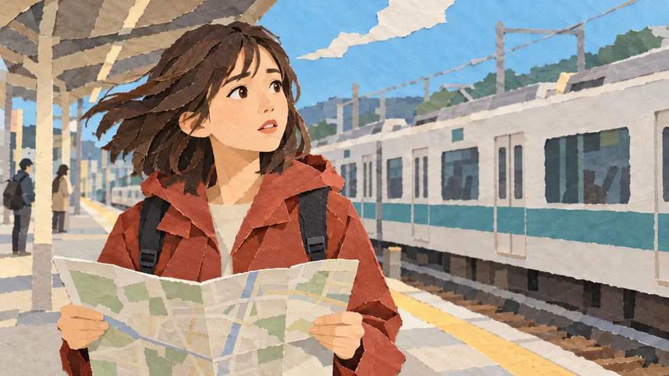

Layered paper and simplified silhouettes turn a scene into a quiet visual metaphor. Selective detail leaves intentional breathing room.

Copy this section by itself after your own subject description. It intentionally does not describe the gallery character or train platform.

```text
Render the supplied subject and scene in the following visual style. Render as a collage of plain colored papers. Reduce forms to large paper pieces and retain slightly irregular cut boundaries and paper fibers. Add small physical shadows only where paper layers overlap. Follow the separate subject-and-scene description for people, clothing, objects, and setting; do not add them from this style instruction. Do not render text, logos, or watermarks. Avoid magazine lettering, photographic cutouts, and thick CGI volume. Do not distribute detail evenly. Finish the focal shape and expression carefully, then use technique-appropriate omissions elsewhere: broken contours, fewer shadows, or untouched paper and ground color. Do not add background objects or ornaments. Give empty areas a deliberate compositional role; do not substitute low resolution or all-over blur.
```

**Watch for:** Avoid magazine lettering, photographic cutouts, and thick CGI volume; these can obscure the technique.
**Cover layout:** For a portrait cover, keep the upper 25% low in detail and place the subject and any face below the center. Typeset the title and author name afterward.

### Literary: Thin-Layer Oil

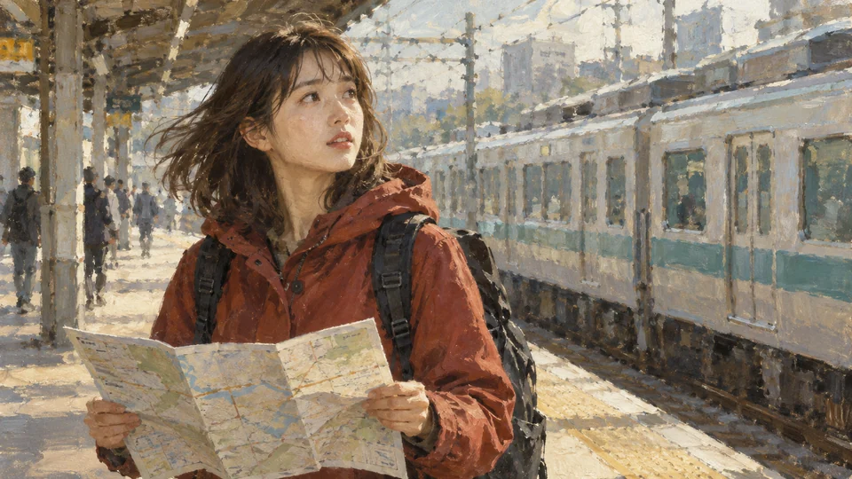

Layered color and lost edges give a scene a sense of accumulated time.

Copy this section by itself after your own subject description. It intentionally does not describe the gallery character or train platform.

```text
Render the supplied subject and scene in the following visual style. Render as thinly layered oil painting with calm colors built up in several layers. Let contours emerge from light-dark boundaries and lose them in shadow. Place small opaque brush touches at the focal point and let the canvas weave show through thin background layers. Follow the separate subject-and-scene description for people, clothing, objects, and setting; do not add them from this style instruction. Do not render text, logos, or watermarks. Avoid heavy impasto everywhere and glossy CGI surfaces.
```

**Watch for:** Avoid heavy impasto everywhere and glossy CGI surfaces; these can obscure the technique.
**Cover layout:** For a portrait cover, keep the upper 25% low in detail and place the subject and any face below the center. Typeset the title and author name afterward.

### Literary: Charcoal Presence

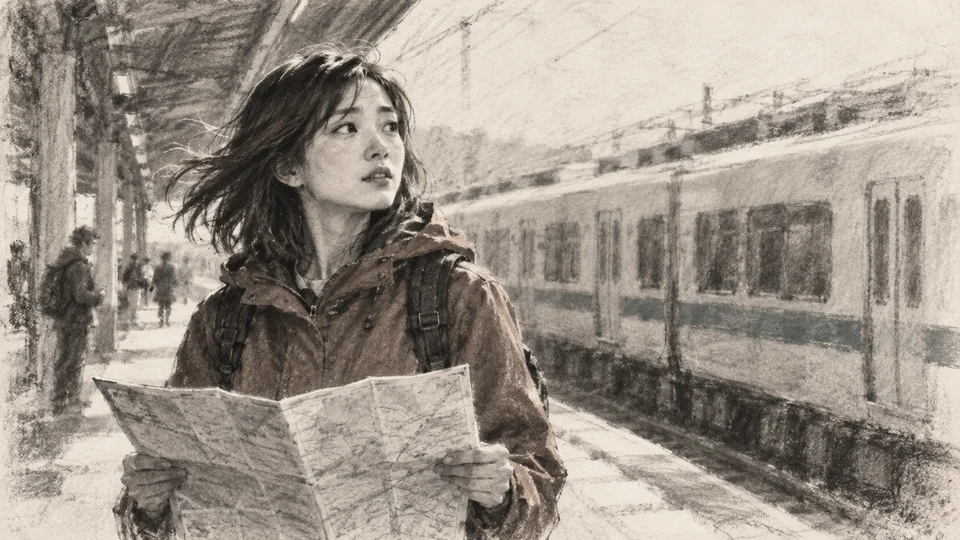

Uncertain edges and strong values suggest an inward emotional movement. Selective detail leaves intentional breathing room.

Copy this section by itself after your own subject description. It intentionally does not describe the gallery character or train platform.

```text
Render the supplied subject and scene in the following visual style. Draw broad light-dark masses with charcoal, using soft finger-rubbed grays and light lifted with a kneaded eraser. Indicate only the focal features with sharp charcoal lines and interrupt other edges. Preserve paper tooth and traces of powder. Follow the separate subject-and-scene description for people, clothing, objects, and setting; do not add them from this style instruction. Do not render text, logos, or watermarks. Avoid precise pen contours and uniformly blurred surfaces. Do not distribute detail evenly. Finish the focal shape and expression carefully, then use technique-appropriate omissions elsewhere: broken contours, fewer shadows, or untouched paper and ground color. Do not add background objects or ornaments. Give empty areas a deliberate compositional role; do not substitute low resolution or all-over blur.
```

**Watch for:** Avoid precise pen contours and uniformly blurred surfaces; these can obscure the technique.
**Cover layout:** For a portrait cover, keep the upper 25% low in detail and place the subject and any face below the center. Typeset the title and author name afterward.

### Literary: Drypoint

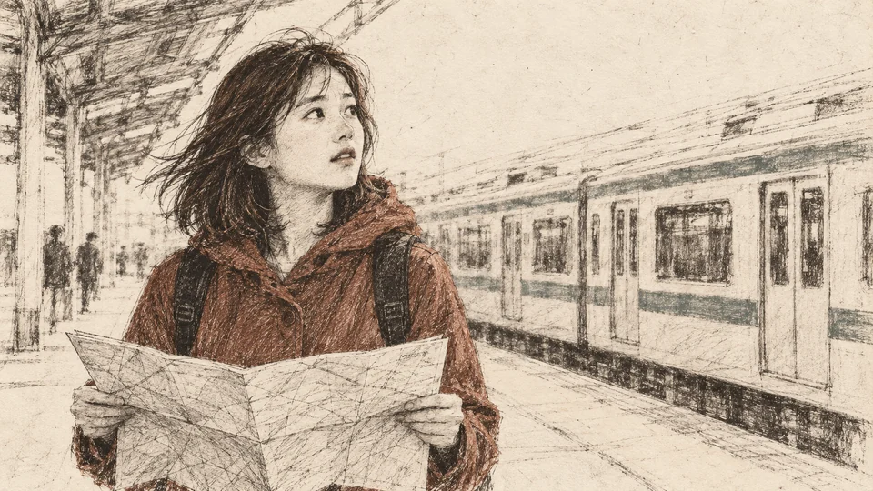

Sharp scratched lines carry a soft fringe of ink for a delicate print surface. Selective detail leaves intentional breathing room.

Copy this section by itself after your own subject description. It intentionally does not describe the gallery character or train platform.

```text
Render the supplied subject and scene in the following visual style. Render as a drypoint print, using fine directly scratched lines and the soft ink fringe held by their burr. Build values with successive lines and leave wiped paper color in open areas. Follow the separate subject-and-scene description for people, clothing, objects, and setting; do not add them from this style instruction. Do not render text, logos, or watermarks. Avoid perfectly uniform copperplate lines and broad brushed washes. Do not distribute detail evenly. Finish the focal shape and expression carefully, then use technique-appropriate omissions elsewhere: broken contours, fewer shadows, or untouched paper and ground color. Do not add background objects or ornaments. Give empty areas a deliberate compositional role; do not substitute low resolution or all-over blur.
```

**Watch for:** Avoid perfectly uniform copperplate lines and broad brushed washes; these can obscure the technique.
**Cover layout:** For a portrait cover, keep the upper 25% low in detail and place the subject and any face below the center. Typeset the title and author name afterward.

### Natural-Light Everyday Photo

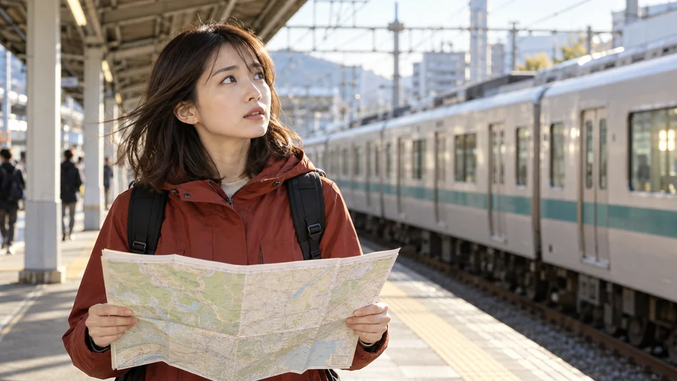

A quietly observed everyday photograph with believable light and tactile detail.

Copy this section by itself after your own subject description. It intentionally does not describe the gallery character or train platform.

```text
Render the supplied subject and scene in the following visual style. Render as a natural digital editorial photograph, not an illustration. Use an ordinary 50mm viewpoint and the available light described in the scene. Preserve natural anatomy, subtle skin texture, and the actual surface of objects. Keep the focal subject clear and the setting readable, with gentle depth separation and restrained color. Favor an unposed everyday moment. Follow the separate subject-and-scene description for people, clothing, objects, and setting; do not add them from this style instruction. Do not render text, logos, or watermarks. Avoid airbrushed skin, artificial film-grain overlays, exaggerated bokeh, and glossy advertising staging.
```

**Watch for:** Avoid airbrushed skin, artificial film-grain overlays, exaggerated bokeh, and glossy advertising staging; these can obscure the technique.
**Cover layout:** For a portrait cover, keep the upper 25% low in detail and place the subject and any face below the center. Typeset the title and author name afterward.

### Cinematic Still Photograph

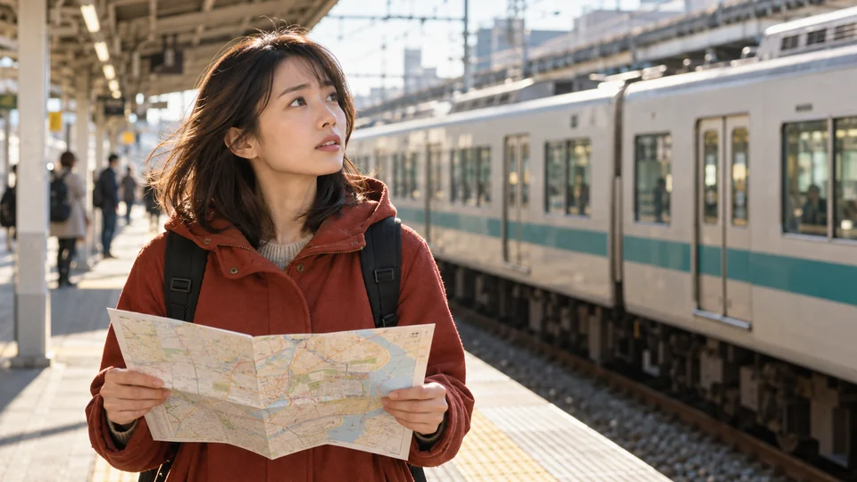

A measured cinematic frame with strong value grouping rather than excessive effects.

Copy this section by itself after your own subject description. It intentionally does not describe the gallery character or train platform.

```text
Render the supplied subject and scene in the following visual style. Render as a live-action film still. Use a natural 35mm viewpoint, physically motivated light, broad shadow groups, and a controlled warm-cool color relationship. Preserve the supplied time of day and scene; do not turn daylight into night. Keep the focal subject readable and the background organized into larger masses. Preserve realistic anatomy and materials. Follow the separate subject-and-scene description for people, clothing, objects, and setting; do not add them from this style instruction. Do not render text, logos, or watermarks. Avoid unrequested fog, neon, lens-flare effects, crushed shadows, and dramatic costume changes.
```

**Watch for:** Avoid unrequested fog, neon, lens-flare effects, crushed shadows, and dramatic costume changes; these can obscure the technique.
**Cover layout:** For a portrait cover, keep the upper 25% low in detail and place the subject and any face below the center. Typeset the title and author name afterward.

### Medium-Format Editorial Photo

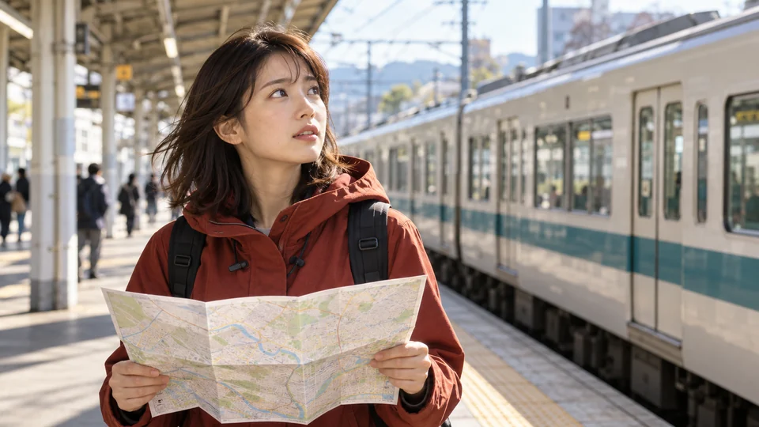

Subtle material detail and broad tonal range for a refined photographic cover.

Copy this section by itself after your own subject description. It intentionally does not describe the gallery character or train platform.

```text
Render the supplied subject and scene in the following visual style. Render as a medium-format editorial photograph with a normal portrait lens perspective. Preserve smooth tonal transitions, detailed natural skin and fabric when present, and believable reflected light. Use a calm observational pose already specified by the scene. Keep the focal area crisp and the background gently separated without extreme blur. Use restrained, true-to-material color. Follow the separate subject-and-scene description for people, clothing, objects, and setting; do not add them from this style instruction. Do not render text, logos, or watermarks. Avoid plastic skin, excessive sharpening, artificial glow, and shallow focus that hides the setting.
```

**Watch for:** Avoid plastic skin, excessive sharpening, artificial glow, and shallow focus that hides the setting; these can obscure the technique.
**Cover layout:** For a portrait cover, keep the upper 25% low in detail and place the subject and any face below the center. Typeset the title and author name afterward.

### High-Key Quiet Photograph


Bright, spacious photography with a few carefully defined forms.

Copy this section by itself after your own subject description. It intentionally does not describe the gallery character or train platform.

```text
Render the supplied subject and scene in the following visual style. Render as a bright high-key natural photograph. Use soft available light, lifted shadow values, and restrained contrast while retaining texture in highlights. Give the focal subject clear edges and natural material detail; simplify the background through low contrast and uncluttered tonal grouping. Preserve the scene and do not add props. Leave quiet light areas deliberately open. Follow the separate subject-and-scene description for people, clothing, objects, and setting; do not add them from this style instruction. Do not render text, logos, or watermarks. Avoid blown-out faces, global blur, fake white cutout backgrounds, and commercial beauty retouching. Do not distribute detail evenly. Finish the focal shape and expression carefully, then use technique-appropriate omissions elsewhere: broken contours, fewer shadows, or untouched paper and ground color. Do not add background objects or ornaments. Give empty areas a deliberate compositional role; do not substitute low resolution or all-over blur.
```

**Watch for:** Avoid blown-out faces, global blur, fake white cutout backgrounds, and commercial beauty retouching; these can obscure the technique.
**Cover layout:** For a portrait cover, keep the upper 25% low in detail and place the subject and any face below the center. Typeset the title and author name afterward.

### Monochrome Documentary Photo

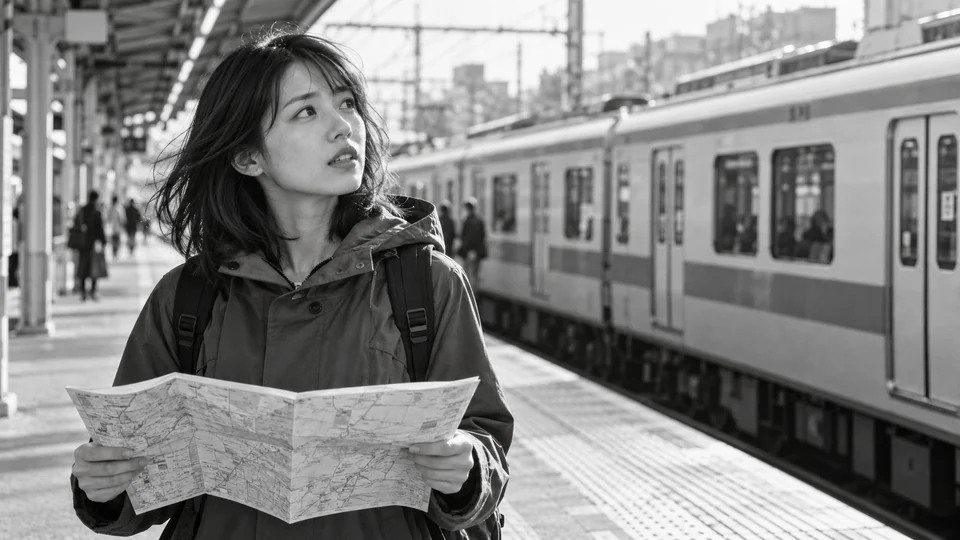

Everyday narrative expressed through light, gesture, and black-and-white value.

Copy this section by itself after your own subject description. It intentionally does not describe the gallery character or train platform.

```text
Render the supplied subject and scene in the following visual style. Render as an observed black-and-white documentary photograph. Use a natural 40mm perspective and available light. Preserve realistic anatomy and unposed gestures. Translate the scene into well-separated charcoal, gray, and luminous light values with natural surface texture and fine organic photographic grain. Keep the setting legible rather than dissolving it into extreme bokeh. Follow the separate subject-and-scene description for people, clothing, objects, and setting; do not add them from this style instruction. Do not render text, logos, or watermarks. Avoid color accents, illustration outlines, high-fashion staging, and aggressive grain overlays.
```

**Watch for:** Avoid color accents, illustration outlines, high-fashion staging, and aggressive grain overlays; these can obscure the technique.
**Cover layout:** For a portrait cover, keep the upper 25% low in detail and place the subject and any face below the center. Typeset the title and author name afterward.

### Fiction: Warm Editorial Realism

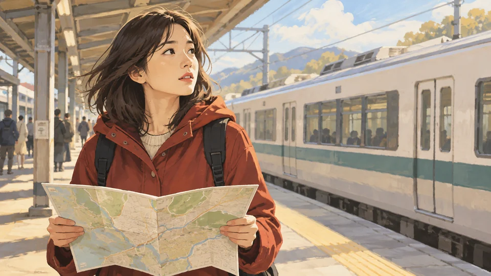

Approachable people and places drawn with the warmth of a general-fiction cover.

Copy this section by itself after your own subject description. It intentionally does not describe the gallery character or train platform.

```text
Render the supplied subject and scene in the following visual style. Render as a hand-painted editorial illustration for general fiction, using natural human proportions rather than large anime eyes. Use soft drawn contours, broad matte color planes, and a few gently modeled shadows. Keep expressions and gestures readable when people appear. Concentrate detail around the focal subject and simplify the setting into welcoming, coherent shapes. Follow the separate subject-and-scene description for people, clothing, objects, and setting; do not add them from this style instruction. Do not render text, logos, or watermarks. Avoid photorealistic skin, glossy game rendering, oversized anime features, and overly cute proportions.
```

**Watch for:** Avoid photorealistic skin, glossy game rendering, oversized anime features, and overly cute proportions; these can obscure the technique.
**Cover layout:** For a portrait cover, keep the upper 25% low in detail and place the subject and any face below the center. Typeset the title and author name afterward.

### Fiction: Storytelling Travel Poster

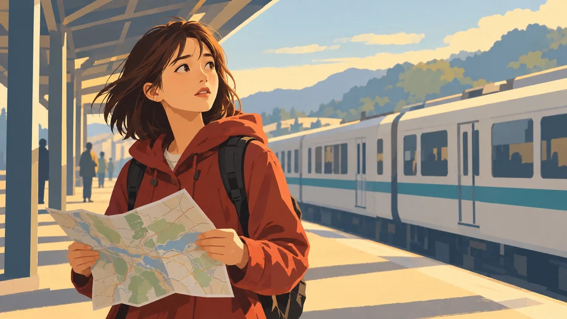

A sense of place and journey conveyed by broad shapes with generous breathing room. Selective detail leaves intentional breathing room.

Copy this section by itself after your own subject description. It intentionally does not describe the gallery character or train platform.

```text
Render the supplied subject and scene in the following visual style. Render as a narrative travel-poster illustration without lettering. Simplify architecture, landscape, and the main subject into broad graphic silhouettes and five to seven color families. Show distance through overlaps and reduced contrast, not tiny background details. Keep human proportions natural when people appear. Compose a clear focal area with generous low-detail surroundings. Follow the separate subject-and-scene description for people, clothing, objects, and setting; do not add them from this style instruction. Do not render text, logos, or watermarks. Avoid tourist lettering, ornate borders, microscopic architecture, and realistic skin shading. Do not distribute detail evenly. Finish the focal shape and expression carefully, then use technique-appropriate omissions elsewhere: broken contours, fewer shadows, or untouched paper and ground color. Do not add background objects or ornaments. Give empty areas a deliberate compositional role; do not substitute low resolution or all-over blur.
```

**Watch for:** Avoid tourist lettering, ornate borders, microscopic architecture, and realistic skin shading; these can obscure the technique.
**Cover layout:** For a portrait cover, keep the upper 25% low in detail and place the subject and any face below the center. Typeset the title and author name afterward.

### Fiction: Colored-Pencil Narrative

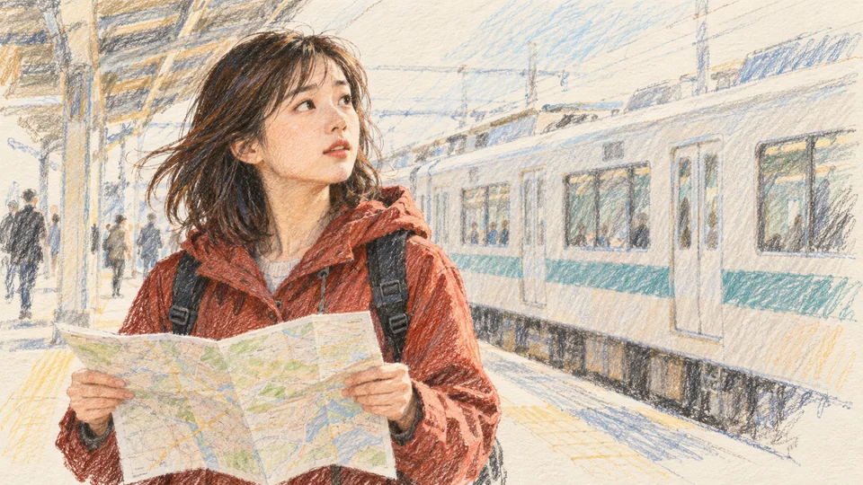

A familiar, intimate drawing language with selective detail and open paper. Selective detail leaves intentional breathing room.

Copy this section by itself after your own subject description. It intentionally does not describe the gallery character or train platform.

```text
Render the supplied subject and scene in the following visual style. Render as a colored-pencil illustration with natural proportions. Build color through layered short strokes and small changes in pencil pressure, allowing paper tooth to remain visible. Describe the focal face, hands, or object carefully, then use incomplete contours and sparse marks in the setting. Keep gestures and material character readable without filling every area. Follow the separate subject-and-scene description for people, clothing, objects, and setting; do not add them from this style instruction. Do not render text, logos, or watermarks. Avoid anime caricatures, smooth digital airbrush, uniform scratch textures, and fully shaded backgrounds. Do not distribute detail evenly. Finish the focal shape and expression carefully, then use technique-appropriate omissions elsewhere: broken contours, fewer shadows, or untouched paper and ground color. Do not add background objects or ornaments. Give empty areas a deliberate compositional role; do not substitute low resolution or all-over blur.
```

**Watch for:** Avoid anime caricatures, smooth digital airbrush, uniform scratch textures, and fully shaded backgrounds; these can obscure the technique.
**Cover layout:** For a portrait cover, keep the upper 25% low in detail and place the subject and any face below the center. Typeset the title and author name afterward.

### Fiction: Narrative Acrylic

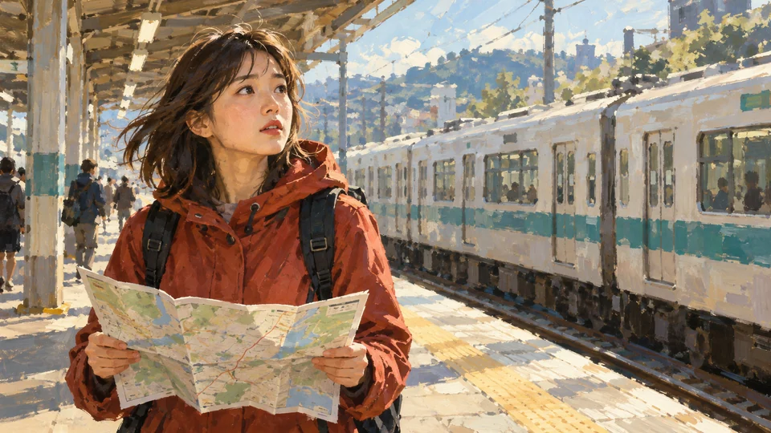

A lively painted scene with tactile marks and focused narrative detail.

Copy this section by itself after your own subject description. It intentionally does not describe the gallery character or train platform.

```text
Render the supplied subject and scene in the following visual style. Render as a narrative acrylic illustration with natural human proportions and believable environmental shapes. Use layered opaque paint, broad visible brushstrokes, and small sharper touches at the focal subject. Distinguish sunlight and shade with large value groups. Let background brushwork remain loose while keeping the story action clear. Use controlled material texture instead of uniform detail. Follow the separate subject-and-scene description for people, clothing, objects, and setting; do not add them from this style instruction. Do not render text, logos, or watermarks. Avoid anime facial conventions, polished photographic rendering, thick paint everywhere, and equal detail in every corner.
```

**Watch for:** Avoid anime facial conventions, polished photographic rendering, thick paint everywhere, and equal detail in every corner; these can obscure the technique.
**Cover layout:** For a portrait cover, keep the upper 25% low in detail and place the subject and any face below the center. Typeset the title and author name afterward.

### Fiction: Geometric Editorial

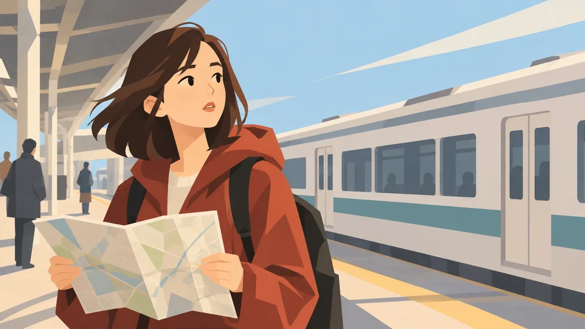

Quiet visual storytelling through simplified human forms and spatial rhythm. Selective detail leaves intentional breathing room.

Copy this section by itself after your own subject description. It intentionally does not describe the gallery character or train platform.

```text
Render the supplied subject and scene in the following visual style. Render as a geometric editorial illustration. Reduce the subject and setting to a small vocabulary of curved and angular shapes, with a limited matte palette and very few shadow planes. Keep human proportions recognizable but faces minimally indicated when people appear. Use overlaps and spatial rhythm to suggest the story, leaving broad areas open without adding symbolic props. Follow the separate subject-and-scene description for people, clothing, objects, and setting; do not add them from this style instruction. Do not render text, logos, or watermarks. Avoid anime eye detail, realistic volume, ornamental patterns, and unrelated symbols. Do not distribute detail evenly. Finish the focal shape and expression carefully, then use technique-appropriate omissions elsewhere: broken contours, fewer shadows, or untouched paper and ground color. Do not add background objects or ornaments. Give empty areas a deliberate compositional role; do not substitute low resolution or all-over blur.
```

**Watch for:** Avoid anime eye detail, realistic volume, ornamental patterns, and unrelated symbols; these can obscure the technique.
**Cover layout:** For a portrait cover, keep the upper 25% low in detail and place the subject and any face below the center. Typeset the title and author name afterward.
