# Prompt Library — ChatGPT image generation

Use these as two independent pieces: a character and scene prompt for the gallery example, and a visual style prompt for the rendering treatment. To make your own image in a style, write your own subject description and paste only that style's prompt after it. To approach a gallery example, paste the shared character and scene prompt followed by its style prompt.

Copy-ready prompts are English in both display languages. Every current sample was generated with the same English technique and shared subject instructions available from its full-sample copy action. Earlier Japanese-generated samples have been replaced, and their records are archived in site/provenance/. The exact submitted text and each current image checksum are recorded in [`site/benchmark-manifest.json`](site/benchmark-manifest.json). The image tool did not expose a seed or underlying model version, so the same prompt can produce a different composition on another run.

Text prompts target the visible technique, not an identical image. For a closer match to a gallery image, attach that image in ChatGPT as a visual reference and say to preserve its medium, mark making, palette, and texture while following your subject description. Keep the same image model and output shape when comparing results, then inspect repeated generations. [OpenAI's image prompting guide](https://developers.openai.com/api/docs/guides/image-prompting) describes reference-based edits and consistency checks.

## Character and scene — shared benchmark

Benchmark ID: `station-map-v3` · Version: `3.0`. This prompt deliberately contains the person, pose, setting, and composition. It can be replaced in full when you want a different subject.

```text
Create one wide 16:9 landscape image, with no border or typography. A young adult East Asian woman with shoulder-length dark brown hair blowing gently to the left and expressive brown eyes wears a rust-red hooded coat and a black backpack. She holds an unfolded paper map in both hands at chest level, with the entire map visible near the lower edge. Frame her from the waist up in a medium close-up, slightly left of center: her head, torso, and map should fill most of the left half of the image. Her body is turned three-quarters to the right, and she looks up toward the right with a curious, slightly uncertain expression. She stands on a sunlit outdoor commuter-train platform. A long white commuter train with a muted teal stripe remains clearly visible across the right half of the background. The platform canopy and columns recede diagonally from the upper left; a few indistinct commuters stand far behind her. Keep the woman, map, platform, and train all clearly visible.
```

## Visual style prompts

### Watercolor


Transparent washes let the paper glow through, while water softens boundaries and gathers pigment at the edges.

Copy this section by itself after your own subject description. It intentionally does not describe the gallery character or train platform.

```text
Render the subject as a hand-painted watercolor illustration with contemporary Japanese animation-inspired drawing when people appear: simplified expressive faces and very fine pencil-like contours, never photorealistic skin. Layer transparent pigment over visible cold-press paper. Let pale powder-blue and warm beige washes bleed and pool softly in the background while retaining crisp, delicate detail at the focal face and hands. Leave luminous paper-white highlights and use one richer warm accent from the subject. The result should feel airy and visibly painted with water. Avoid realistic portrait rendering, opaque digital paint, thick black outlines, and smooth computer gradients.
```

**Watch for:** If every edge is sharp and opaque, the result can read as digital painting rather than watercolor.
**Cover layout:** For a portrait cover, request separate space for the title. Typeset the lettering afterward.

### Risograph


A stencil printing process with a small ink palette, textured solids, and imperfect color registration.

Copy this section by itself after your own subject description. It intentionally does not describe the gallery character or train platform.

```text
Render the subject as a two-color risograph print on warm off-white uncoated paper. Use only deep midnight-navy and warm coral-orange spot inks, plus the third dark tone formed where they overlap; let the paper supply the light areas. Reduce the image to bold graphic shapes and strong contours. If a person appears, keep their expression readable through simplified comic-like features. Build midtones from coarse halftone dots and irregular ink grain, with slight visible misregistration between the two plates and imperfect ink coverage. Avoid full-color gradients, clean vector flatness, photographic shading, and uniform digital-noise overlays.
```

**Watch for:** A uniform digital noise overlay is not a substitute for uneven ink and interacting color layers.
**Cover layout:** For a portrait cover, request separate space for the title. Typeset the lettering afterward.

### Gouache


Opaque, matte color creates confident shapes with hand-painted transitions and softly visible brushwork.

Copy this section by itself after your own subject description. It intentionally does not describe the gallery character or train platform.

```text
Render the subject as an opaque gouache illustration with the warmth of hand-painted Japanese animation background art. Use broad, confident matte color shapes, layered opaque paint, softly visible bristle marks, and edges shaped by the brush rather than heavy ink outlines. If a person appears, give them simplified expressive drawn features. Balance muted powder blues, warm stone neutrals, and one earthy red accent; let soft daylight separate foreground and distance. Preserve enough surface texture to feel painted on paper. Avoid transparent watercolor blooms, glossy acrylic shine, photorealistic skin, and perfectly smooth vector fills.
```

**Watch for:** Excess shine or transparent washes can make the image look like acrylic or watercolor instead.
**Cover layout:** For a portrait cover, request separate space for the title. Typeset the lettering afterward.

### Ink Wash


Diluted ink describes form through value, gesture, and the balance between marks and untouched paper.

Copy this section by itself after your own subject description. It intentionally does not describe the gallery character or train platform.

```text
Render the subject as an expressive ink-wash illustration on absorbent off-white paper. Build almost the entire image from black ink diluted into soft gray tonal washes, reserved white paper, and a few energetic dark calligraphic marks. When a person appears, use delicate manga-inspired contour lines around the face and hands, with simplified expressive features. Permit a single muted rust-red accent on the main subject; reinterpret every other color specified in the subject description as grayscale, including clothing and background details. Let distant forms dissolve into wet washes while focal details remain legible. Avoid photographic grayscale, full-color watercolor, polished digital gradients, and uniformly heavy outlines.
```

**Watch for:** Pure grayscale with photographic shading misses the expressive role of brush marks and open paper.
**Cover layout:** For a portrait cover, request separate space for the title. Typeset the lettering afterward.

### Pixel Art


Shapes are deliberately designed on a small pixel grid, using clusters of flat color rather than smooth gradients.

Copy this section by itself after your own subject description. It intentionally does not describe the gallery character or train platform.

```text
Render the subject as carefully authored 2D pixel art for a narrative adventure game. Design on a low-resolution pixel grid, roughly 320 by 180 logical pixels for a wide scene, then display it with crisp nearest-neighbor enlargement. Use a limited palette of navy, slate blue, warm cream, peach, and rust red. Build forms from intentional square pixel clusters, stepped contours, flat color bands, and discrete shade changes; use readable anime-inspired sprite features if people appear. Keep the background architecture legible without fine photographic detail. Avoid blur, antialiasing, smooth gradients, vector outlines, and a merely downsampled photograph.
```

**Watch for:** A blurry low-resolution picture is not pixel art; every cluster should look intentional.
**Cover layout:** For a portrait cover, request separate space for the title. Typeset the lettering afterward.

### 35mm Film


A photographic look shaped by organic grain, gentle highlight rolloff, and slightly imperfect color response.

Copy this section by itself after your own subject description. It intentionally does not describe the gallery character or train platform.

```text
Render the subject as a candid photograph on 35mm color negative film, not an illustration. Use a natural 50mm documentary viewpoint, available light, gentle backlight when the scene permits, soft highlight rolloff, muted warm highlights, and slightly cool teal shadows. Keep the primary subject in believable focus while the background softens naturally through lens depth of field. If a person appears, preserve natural anatomy and an unposed expression. Add fine organic grain and slight exposure variation in the image itself, without making it look like a digital noise filter. Favor an observed everyday moment over polished commercial staging. Avoid airbrushed skin, heavy cinematic color grading, extreme bokeh, and painterly or anime rendering.
```

**Watch for:** An aggressive grain overlay alone will not create believable lens, light, and color behavior.
**Cover layout:** For a portrait cover, request separate space for the title. Typeset the lettering afterward.

### Flat Japanese Anime


Light, clear illustration built from silhouettes and flat color.

Copy this section by itself after your own subject description. It intentionally does not describe the gallery character or train platform.

```text
Render the supplied subject and scene in the following visual style. Use fine, even outlines around closed shapes and no more than eight flat colors across the image. Do not add shadow colors, highlights, or gradients to any material. Treat hair and clothing, when present, as single color shapes. Simplify objects to a silhouette and a few identifying lines. Reduce the background to its essential shapes, omitting reflections, cast shadows, and distant small details. Show depth only through overlaps. When people appear, use concise Japanese anime features and natural proportions. Leave areas deliberately undescribed, as in a flat hand-drawn illustration. Follow the separate subject-and-scene description for people, clothing, objects, and setting; do not add them from this style instruction. Do not render text, logos, or watermarks. Avoid gradients, modeled skin, and intricate backgrounds.
```

**Watch for:** Avoid gradients, modeled skin, and intricate backgrounds; these can obscure the technique.
**Cover layout:** For a portrait cover, keep the upper 25% low in detail and place the subject and any face below the center. Typeset the title and author name afterward.

### Two-Tone Cel Shading


Readable characters with the crisp shadow shapes of TV animation.

Copy this section by itself after your own subject description. It intentionally does not describe the gallery character or train platform.

```text
Render the supplied subject and scene in the following visual style. Paint each material using its base color and a single shadow color. Keep shadow boundaries hard and the light direction consistent. When people appear, simplify the face and hands in a Japanese anime drawing language, with small, clearly organized shadows. Follow the separate subject-and-scene description for people, clothing, objects, and setting; do not add them from this style instruction. Do not render text, logos, or watermarks. Avoid airbrushed blur and multiple layers of reflected light.
```

**Watch for:** Avoid airbrushed blur and multiple layers of reflected light; these can obscure the technique.
**Cover layout:** For a portrait cover, keep the upper 25% low in detail and place the subject and any face below the center. Typeset the title and author name afterward.

### Lineless Anime


Gentle silhouettes defined by neighboring color shapes instead of ink outlines. Selective detail leaves intentional breathing room.

Copy this section by itself after your own subject description. It intentionally does not describe the gallery character or train platform.

```text
Render the supplied subject and scene in the following visual style. Omit exterior contour lines and define boundaries with adjacent color shapes and value differences. Keep only a few fine internal lines for essential features such as eyes and noses. Use simplified anime forms, dividing hair and clothing into broad shapes when present. Follow the separate subject-and-scene description for people, clothing, objects, and setting; do not add them from this style instruction. Do not render text, logos, or watermarks. Avoid black edging and photorealistic shading. Do not distribute detail evenly. Finish the focal shape and expression carefully, then use technique-appropriate omissions elsewhere: broken contours, fewer shadows, or untouched paper and ground color. Do not add background objects or ornaments. Give empty areas a deliberate compositional role; do not substitute low resolution or all-over blur.
```

**Watch for:** Avoid black edging and photorealistic shading; these can obscure the technique.
**Cover layout:** For a portrait cover, keep the upper 25% low in detail and place the subject and any face below the center. Typeset the title and author name afterward.

### Bold-Line Pop Anime


Energetic silhouettes that stay readable at small cover sizes.

Copy this section by itself after your own subject description. It intentionally does not describe the gallery character or train platform.

```text
Render the supplied subject and scene in the following visual style. Enclose silhouettes with thick outlines and rounded line endings; use fewer interior lines. Paint broad color fields with a single shadow step. Make expressions clear when people appear and organize the background into simple geometric shapes. Follow the separate subject-and-scene description for people, clothing, objects, and setting; do not add them from this style instruction. Do not render text, logos, or watermarks. Avoid crowded fine lines and photographic surfaces.
```

**Watch for:** Avoid crowded fine lines and photographic surfaces; these can obscure the technique.
**Cover layout:** For a portrait cover, keep the upper 25% low in detail and place the subject and any face below the center. Typeset the title and author name afterward.

### Hand-Painted Retro Cel


A nostalgic balance of hand-inked characters and painted backgrounds.

Copy this section by itself after your own subject description. It intentionally does not describe the gallery character or train platform.

```text
Render the supplied subject and scene in the following visual style. Retain small changes in hand-drawn line width. Use opaque cel-style flat fills and hard shadows, paired with softer poster-paint brushwork in the background. Leave faint irregularities in the painted surface. Follow the separate subject-and-scene description for people, clothing, objects, and setting; do not add them from this style instruction. Do not render text, logos, or watermarks. Avoid large VHS scan lines and noise-filter imitations.
```

**Watch for:** Avoid large VHS scan lines and noise-filter imitations; these can obscure the technique.
**Cover layout:** For a portrait cover, keep the upper 25% low in detail and place the subject and any face below the center. Typeset the title and author name afterward.

### Manga Screentone


A story moment rendered with black ink, white space, and structured screen tones.

Copy this section by itself after your own subject description. It intentionally does not describe the gallery character or train platform.

```text
Render the supplied subject and scene in the following visual style. Use black ink and white paper only. Vary the pen pressure around contours and build shadows with regular screentone dots and solid black shapes. Preserve more white around the focal face and hands when people appear. Follow the separate subject-and-scene description for people, clothing, objects, and setting; do not add them from this style instruction. Do not render text, logos, or watermarks. Avoid continuous photographic grayscale and uniform grain.
```

**Watch for:** Avoid continuous photographic grayscale and uniform grain; these can obscure the technique.
**Cover layout:** For a portrait cover, keep the upper 25% low in detail and place the subject and any face below the center. Typeset the title and author name afterward.

### Delicate Shojo Linework


Lyrical drawing that gives attention to flowing hair and a quiet gaze. Selective detail leaves intentional breathing room.

Copy this section by itself after your own subject description. It intentionally does not describe the gallery character or train platform.

```text
Render the supplied subject and scene in the following visual style. Draw flowing forms with extremely fine tapered lines, concentrating line density near the focal features. Keep color in pale transparent layers and partially omit background contours. When people appear, emphasize delicate hair and eye lines; use the same fine linework and open white space for other subjects. Follow the separate subject-and-scene description for people, clothing, objects, and setting; do not add them from this style instruction. Do not render text, logos, or watermarks. Avoid mandatory flowers or stars, excessive eyelashes, and heavy shadows. Do not distribute detail evenly. Finish the focal shape and expression carefully, then use technique-appropriate omissions elsewhere: broken contours, fewer shadows, or untouched paper and ground color. Do not add background objects or ornaments. Give empty areas a deliberate compositional role; do not substitute low resolution or all-over blur.
```

**Watch for:** Avoid mandatory flowers or stars, excessive eyelashes, and heavy shadows; these can obscure the technique.
**Cover layout:** For a portrait cover, keep the upper 25% low in detail and place the subject and any face below the center. Typeset the title and author name afterward.

### Playful Chibi Illustration


Friendly, comic illustration for playful stories and short fiction.

Copy this section by itself after your own subject description. It intentionally does not describe the gallery character or train platform.

```text
Render the supplied subject and scene in the following visual style. When people appear, use a larger head and short limbs with roughly three- to four-head-tall proportions. Simplify objects and backgrounds into rounded shapes too. Use two or three flat shade steps, keeping expressions and actions easy to read. Follow the separate subject-and-scene description for people, clothing, objects, and setting; do not add them from this style instruction. Do not render text, logos, or watermarks. Avoid realistic proportions, detailed muscles, and excessive ornament.
```

**Watch for:** Avoid realistic proportions, detailed muscles, and excessive ornament; these can obscure the technique.
**Cover layout:** For a portrait cover, keep the upper 25% low in detail and place the subject and any face below the center. Typeset the title and author name afterward.

### Anime Pencil Rough


Drawing that preserves the liveliness of an animation rough rather than a polished finish. Selective detail leaves intentional breathing room.

Copy this section by itself after your own subject description. It intentionally does not describe the gallery character or train platform.

```text
Render the supplied subject and scene in the following visual style. Use animation-layout pencil contours, faint exploratory redrawn lines, and short hatching. Darken important edges while leaving the background pale. Keep light color fields to a minimum and expose plenty of bare paper. Follow the separate subject-and-scene description for people, clothing, objects, and setting; do not add them from this style instruction. Do not render text, logos, or watermarks. Avoid production notes or color codes and polished cel surfaces. Do not distribute detail evenly. Finish the focal shape and expression carefully, then use technique-appropriate omissions elsewhere: broken contours, fewer shadows, or untouched paper and ground color. Do not add background objects or ornaments. Give empty areas a deliberate compositional role; do not substitute low resolution or all-over blur.
```

**Watch for:** Avoid production notes or color codes and polished cel surfaces; these can obscure the technique.
**Cover layout:** For a portrait cover, keep the upper 25% low in detail and place the subject and any face below the center. Typeset the title and author name afterward.

### Painted Anime Background


Atmospheric setting-led illustration with a clear sense of distance.

Copy this section by itself after your own subject description. It intentionally does not describe the gallery character or train platform.

```text
Render the supplied subject and scene in the following visual style. Paint architecture and nature with fine opaque brushwork in the language of Japanese animation backgrounds. Keep the foreground clear and lower value contrast and saturation in the distance. If people appear, distinguish them from the setting with simple cel shading. Follow the separate subject-and-scene description for people, clothing, objects, and setting; do not add them from this style instruction. Do not render text, logos, or watermarks. Avoid pasted photographs and equal detail everywhere.
```

**Watch for:** Avoid pasted photographs and equal detail everywhere; these can obscure the technique.
**Cover layout:** For a portrait cover, keep the upper 25% low in detail and place the subject and any face below the center. Typeset the title and author name afterward.

### Light Novel: Clear Color


Clean, readable character illustration with restrained luminous color.

Copy this section by itself after your own subject description. It intentionally does not describe the gallery character or train platform.

```text
Render the supplied subject and scene in the following visual style. Use precise fine lines and Japanese anime forms. Keep skin shading light when people appear and build transparent light and dark layers along groups of hair. Limit small reflected highlights to the focal area and simplify the background to low-contrast shapes. Follow the separate subject-and-scene description for people, clothing, objects, and setting; do not add them from this style instruction. Do not render text, logos, or watermarks. Avoid strong gloss everywhere and photographic skin.
```

**Watch for:** Avoid strong gloss everywhere and photographic skin; these can obscure the technique.
**Cover layout:** For a portrait cover, keep the upper 25% low in detail and place the subject and any face below the center. Typeset the title and author name afterward.

### Light Novel: Soft Romance


Soft emotional distance for romance and coming-of-age stories. Selective detail leaves intentional breathing room.

Copy this section by itself after your own subject description. It intentionally does not describe the gallery character or train platform.

```text
Render the supplied subject and scene in the following visual style. Draw fine contours close to each local color and let soft backlight brighten or lose selected edges. Use anime forms and pale gradients, with shallow facial shadows when people appear. Simplify everything away from the focal area into large gentle shapes. Follow the separate subject-and-scene description for people, clothing, objects, and setting; do not add them from this style instruction. Do not render text, logos, or watermarks. Avoid mandatory petals or hearts and excessive bokeh circles. Do not distribute detail evenly. Finish the focal shape and expression carefully, then use technique-appropriate omissions elsewhere: broken contours, fewer shadows, or untouched paper and ground color. Do not add background objects or ornaments. Give empty areas a deliberate compositional role; do not substitute low resolution or all-over blur.
```

**Watch for:** Avoid mandatory petals or hearts and excessive bokeh circles; these can obscure the technique.
**Cover layout:** For a portrait cover, keep the upper 25% low in detail and place the subject and any face below the center. Typeset the title and author name afterward.

### Light Novel: Angular Action


Tension expressed through sharp edges, directional shapes, and strong value groups.

Copy this section by itself after your own subject description. It intentionally does not describe the gallery character or train platform.

```text
Render the supplied subject and scene in the following visual style. Give contours sharp corners and varied weight. Organize fabric and hair into directional shapes when present. Divide light and dark into large groups and concentrate contrast at the focal area. Preserve the supplied scene while using diagonal rhythms to create tension. Follow the separate subject-and-scene description for people, clothing, objects, and setting; do not add them from this style instruction. Do not render text, logos, or watermarks. Avoid unrequested weapons or explosions and meaningless speed lines.
```

**Watch for:** Avoid unrequested weapons or explosions and meaningless speed lines; these can obscure the technique.
**Cover layout:** For a portrait cover, keep the upper 25% low in detail and place the subject and any face below the center. Typeset the title and author name afterward.

### Light Novel: Painterly Fantasy


Painterly depth and material variation suited to imaginative fiction.

Copy this section by itself after your own subject description. It intentionally does not describe the gallery character or train platform.

```text
Render the supplied subject and scene in the following visual style. Retain anime-influenced character forms when people appear, while modeling clothing and the setting with thin layers of opaque brushwork. Vary reflection and brush marks by material, concentrating detail at the focal area. Group the background into broad light and dark masses. Follow the separate subject-and-scene description for people, clothing, objects, and setting; do not add them from this style instruction. Do not render text, logos, or watermarks. Avoid unrequested magic circles, gems, or costume changes.
```

**Watch for:** Avoid unrequested magic circles, gems, or costume changes; these can obscure the technique.
**Cover layout:** For a portrait cover, keep the upper 25% low in detail and place the subject and any face below the center. Typeset the title and author name afterward.

### Light Novel: Quiet Mystery


A dark, restrained illustration that keeps its focal point readable.

Copy this section by itself after your own subject description. It intentionally does not describe the gallery character or train platform.

```text
Render the supplied subject and scene in the following visual style. Use Japanese anime forms with a large shadow group covering roughly half the image. Clarify only the focal contours and let other edges merge into darkness. Use a small local light source and low-saturation color to create quiet tension. Follow the separate subject-and-scene description for people, clothing, objects, and setting; do not add them from this style instruction. Do not render text, logos, or watermarks. Avoid added blood or horror objects and crushed detail everywhere.
```

**Watch for:** Avoid added blood or horror objects and crushed detail everywhere; these can obscure the technique.
**Cover layout:** For a portrait cover, keep the upper 25% low in detail and place the subject and any face below the center. Typeset the title and author name afterward.

### Light Novel: Precise SF


An analytical image that distinguishes structure and material without visual clutter.

Copy this section by itself after your own subject description. It intentionally does not describe the gallery character or train platform.

```text
Render the supplied subject and scene in the following visual style. Draw forms with fine precise anime linework and distinguish reflections on metal, glass, and cloth when those materials are specified. Base shading on hard planes and keep reflected highlights small. Clarify straight structural lines in the background while preserving gentle character expressions. Follow the separate subject-and-scene description for people, clothing, objects, and setting; do not add them from this style instruction. Do not render text, logos, or watermarks. Avoid unrequested machinery or HUD overlays and neon everywhere.
```

**Watch for:** Avoid unrequested machinery or HUD overlays and neon everywhere; these can obscure the technique.
**Cover layout:** For a portrait cover, keep the upper 25% low in detail and place the subject and any face below the center. Typeset the title and author name afterward.

### Light Novel: Brush Ink Color


Expressive ink contours with light color for folklore or literary fantasy.

Copy this section by itself after your own subject description. It intentionally does not describe the gallery character or train platform.

```text
Render the supplied subject and scene in the following visual style. Make the speed and pressure of brush-pen contours the main visual language. Fill interiors with pale color layers and form shadows through line density and a few ink shapes. Concentrate black at the focal area and retain occasional dry-brush breaks. Follow the separate subject-and-scene description for people, clothing, objects, and setting; do not add them from this style instruction. Do not render text, logos, or watermarks. Avoid an all-over ink wash and mandatory traditional clothing or blossoms.
```

**Watch for:** Avoid an all-over ink wash and mandatory traditional clothing or blossoms; these can obscure the technique.
**Cover layout:** For a portrait cover, keep the upper 25% low in detail and place the subject and any face below the center. Typeset the title and author name afterward.

### Light Novel: Pastel Everyday


Warm everyday scenes with a soft, tactile, powder-on-paper finish. Selective detail leaves intentional breathing room.

Copy this section by itself after your own subject description. It intentionally does not describe the gallery character or train platform.

```text
Render the supplied subject and scene in the following visual style. Use calm anime forms when people appear and soft contours resembling colored pencil. Apply color as fine pastel powder on paper, lightly rubbing boundaries between overlapping layers. Keep shadows shallow and leave plenty of white visible. Follow the separate subject-and-scene description for people, clothing, objects, and setting; do not add them from this style instruction. Do not render text, logos, or watermarks. Avoid photorealistic pastel portraits and strong black outlines. Do not distribute detail evenly. Finish the focal shape and expression carefully, then use technique-appropriate omissions elsewhere: broken contours, fewer shadows, or untouched paper and ground color. Do not add background objects or ornaments. Give empty areas a deliberate compositional role; do not substitute low resolution or all-over blur.
```

**Watch for:** Avoid photorealistic pastel portraits and strong black outlines; these can obscure the technique.
**Cover layout:** For a portrait cover, keep the upper 25% low in detail and place the subject and any face below the center. Typeset the title and author name afterward.

### Light Novel: Focused Brilliance


Controlled highlights bring a focal point to life without making every surface glossy.

Copy this section by itself after your own subject description. It intentionally does not describe the gallery character or train platform.

```text
Render the supplied subject and scene in the following visual style. Use fine anime outlines and transparent color layers. Place small sharp highlights in hair, eyes, or specified hard materials when present; keep soft materials matte. Concentrate reflected light at the focal point. Follow the separate subject-and-scene description for people, clothing, objects, and setting; do not add them from this style instruction. Do not render text, logos, or watermarks. Avoid added gems, plastic gloss over the whole subject, and oversaturation.
```

**Watch for:** Avoid added gems, plastic gloss over the whole subject, and oversaturation; these can obscure the technique.
**Cover layout:** For a portrait cover, keep the upper 25% low in detail and place the subject and any face below the center. Typeset the title and author name afterward.

### Light Novel: Graphic Cover


Character and geometric rhythms arranged to leave room for a title. Selective detail leaves intentional breathing room.

Copy this section by itself after your own subject description. It intentionally does not describe the gallery character or train platform.

```text
Render the supplied subject and scene in the following visual style. Render the main subject with clear anime contours and two or three shade steps. Reduce concrete background objects to their necessary shapes and compose with broad planes and diagonal rhythms. Leave low-detail space around the focal area. Follow the separate subject-and-scene description for people, clothing, objects, and setting; do not add them from this style instruction. Do not render text, logos, or watermarks. Avoid generated lettering and crowded decorative shapes. Do not distribute detail evenly. Finish the focal shape and expression carefully, then use technique-appropriate omissions elsewhere: broken contours, fewer shadows, or untouched paper and ground color. Do not add background objects or ornaments. Give empty areas a deliberate compositional role; do not substitute low resolution or all-over blur.
```

**Watch for:** Avoid generated lettering and crowded decorative shapes; these can obscure the technique.
**Cover layout:** For a portrait cover, keep the upper 25% low in detail and place the subject and any face below the center. Typeset the title and author name afterward.

### Literary: Open Line Drawing


Quiet presence expressed through a few considered lines and open paper. Selective detail leaves intentional breathing room.

Copy this section by itself after your own subject description. It intentionally does not describe the gallery character or train platform.

```text
Render the supplied subject and scene in the following visual style. Draw only the identifying features of the subject with a few fine ink lines. Break contours in selected places and restrict shading to very few short strokes. Keep only essential background edges and use broad bare-paper areas to create breathing room. Follow the separate subject-and-scene description for people, clothing, objects, and setting; do not add them from this style instruction. Do not render text, logos, or watermarks. Avoid dense all-over hatching and enormous solid-black areas. Do not distribute detail evenly. Finish the focal shape and expression carefully, then use technique-appropriate omissions elsewhere: broken contours, fewer shadows, or untouched paper and ground color. Do not add background objects or ornaments. Give empty areas a deliberate compositional role; do not substitute low resolution or all-over blur.
```

**Watch for:** Avoid dense all-over hatching and enormous solid-black areas; these can obscure the technique.
**Cover layout:** For a portrait cover, keep the upper 25% low in detail and place the subject and any face below the center. Typeset the title and author name afterward.

### Literary: Graphite Sketch


Tactile pencil values that suggest memory without finishing every edge. Selective detail leaves intentional breathing room.

Copy this section by itself after your own subject description. It intentionally does not describe the gallery character or train platform.

```text
Render the supplied subject and scene in the following visual style. Draw with graphite pencil only. Use fine contours, short hatching, and lightly rubbed gray to model forms. Build up lines at the focal point and leave the background faint, as if still being sketched. Preserve uneven graphite catching on the paper tooth. Follow the separate subject-and-scene description for people, clothing, objects, and setting; do not add them from this style instruction. Do not render text, logos, or watermarks. Avoid black-and-white photo conversion and perfectly smooth tonal gradients. Do not distribute detail evenly. Finish the focal shape and expression carefully, then use technique-appropriate omissions elsewhere: broken contours, fewer shadows, or untouched paper and ground color. Do not add background objects or ornaments. Give empty areas a deliberate compositional role; do not substitute low resolution or all-over blur.
```

**Watch for:** Avoid black-and-white photo conversion and perfectly smooth tonal gradients; these can obscure the technique.
**Cover layout:** For a portrait cover, keep the upper 25% low in detail and place the subject and any face below the center. Typeset the title and author name afterward.

### Literary: Copperplate Etching


Dense engraved linework and open paper create weight and a sense of time.

Copy this section by itself after your own subject description. It intentionally does not describe the gallery character or train platform.

```text
Render the supplied subject and scene in the following visual style. Render as a single-ink copperplate etching. Describe forms with fine engraved lines and crosshatching, following the direction of surfaces rather than merely outlining them. Build darkness with line density and preserve the paper ground with faint ink left from wiping. Follow the separate subject-and-scene description for people, clothing, objects, and setting; do not add them from this style instruction. Do not render text, logos, or watermarks. Avoid screentone dots, photographic values, and ornamental plate borders.
```

**Watch for:** Avoid screentone dots, photographic values, and ornamental plate borders; these can obscure the technique.
**Cover layout:** For a portrait cover, keep the upper 25% low in detail and place the subject and any face below the center. Typeset the title and author name afterward.

### Literary: Carved Woodcut


Forceful shapes and rough cuts support stories with gravity and directness.

Copy this section by itself after your own subject description. It intentionally does not describe the gallery character or train platform.

```text
Render the supplied subject and scene in the following visual style. Render as a single-ink woodcut, combining white carved lines with black printing areas. Run short cut marks in the direction of forms and compose with broad black-and-white masses. Keep wood grain and ink breaks in selected areas. Follow the separate subject-and-scene description for people, clothing, objects, and setting; do not add them from this style instruction. Do not render text, logos, or watermarks. Avoid smooth vector shapes and fine copperplate crosshatching.
```

**Watch for:** Avoid smooth vector shapes and fine copperplate crosshatching; these can obscure the technique.
**Cover layout:** For a portrait cover, keep the upper 25% low in detail and place the subject and any face below the center. Typeset the title and author name afterward.

### Literary: Linocut


Simpler shapes and curved cuts offer a smoother alternative to woodcut.

Copy this section by itself after your own subject description. It intentionally does not describe the gallery character or train platform.

```text
Render the supplied subject and scene in the following visual style. Render with the rounded, flowing cut marks of a linoleum print. Organize contours into broad cut lines and overlap two or three color plates. Build shading through repeated curves and large planes, retaining slight unevenness in the ink. Follow the separate subject-and-scene description for people, clothing, objects, and setting; do not add them from this style instruction. Do not render text, logos, or watermarks. Avoid wood grain, dotted screen tones, and photographic shading.
```

**Watch for:** Avoid wood grain, dotted screen tones, and photographic shading; these can obscure the technique.
**Cover layout:** For a portrait cover, keep the upper 25% low in detail and place the subject and any face below the center. Typeset the title and author name afterward.

### Literary: Wiped Monotype


Soft transferred traces suggest an incomplete or uncertain memory. Selective detail leaves intentional breathing room.

Copy this section by itself after your own subject description. It intentionally does not describe the gallery character or train platform.

```text
Render the supplied subject and scene in the following visual style. Render as a one-off monotype, building forms from ink wiped on a plate and soft transferred edges. Keep the main subject readable while allowing the background to dissolve into rubbed marks and thin ink films. Follow the separate subject-and-scene description for people, clothing, objects, and setting; do not add them from this style instruction. Do not render text, logos, or watermarks. Avoid bright watercolor blooms and regular halftone dots. Do not distribute detail evenly. Finish the focal shape and expression carefully, then use technique-appropriate omissions elsewhere: broken contours, fewer shadows, or untouched paper and ground color. Do not add background objects or ornaments. Give empty areas a deliberate compositional role; do not substitute low resolution or all-over blur.
```

**Watch for:** Avoid bright watercolor blooms and regular halftone dots; these can obscure the technique.
**Cover layout:** For a portrait cover, keep the upper 25% low in detail and place the subject and any face below the center. Typeset the title and author name afterward.

### Literary: Cut-Paper Collage


Layered paper and simplified silhouettes turn a scene into a quiet visual metaphor. Selective detail leaves intentional breathing room.

Copy this section by itself after your own subject description. It intentionally does not describe the gallery character or train platform.

```text
Render the supplied subject and scene in the following visual style. Render as a collage of plain colored papers. Reduce forms to large paper pieces and retain slightly irregular cut boundaries and paper fibers. Add small physical shadows only where paper layers overlap. Follow the separate subject-and-scene description for people, clothing, objects, and setting; do not add them from this style instruction. Do not render text, logos, or watermarks. Avoid magazine lettering, photographic cutouts, and thick CGI volume. Do not distribute detail evenly. Finish the focal shape and expression carefully, then use technique-appropriate omissions elsewhere: broken contours, fewer shadows, or untouched paper and ground color. Do not add background objects or ornaments. Give empty areas a deliberate compositional role; do not substitute low resolution or all-over blur.
```

**Watch for:** Avoid magazine lettering, photographic cutouts, and thick CGI volume; these can obscure the technique.
**Cover layout:** For a portrait cover, keep the upper 25% low in detail and place the subject and any face below the center. Typeset the title and author name afterward.

### Literary: Thin-Layer Oil


Layered color and lost edges give a scene a sense of accumulated time.

Copy this section by itself after your own subject description. It intentionally does not describe the gallery character or train platform.

```text
Render the supplied subject and scene in the following visual style. Render as thinly layered oil painting with calm colors built up in several layers. Let contours emerge from light-dark boundaries and lose them in shadow. Place small opaque brush touches at the focal point and let the canvas weave show through thin background layers. Follow the separate subject-and-scene description for people, clothing, objects, and setting; do not add them from this style instruction. Do not render text, logos, or watermarks. Avoid heavy impasto everywhere and glossy CGI surfaces.
```

**Watch for:** Avoid heavy impasto everywhere and glossy CGI surfaces; these can obscure the technique.
**Cover layout:** For a portrait cover, keep the upper 25% low in detail and place the subject and any face below the center. Typeset the title and author name afterward.

### Literary: Charcoal Presence


Uncertain edges and strong values suggest an inward emotional movement. Selective detail leaves intentional breathing room.

Copy this section by itself after your own subject description. It intentionally does not describe the gallery character or train platform.

```text
Render the supplied subject and scene in the following visual style. Draw broad light-dark masses with charcoal, using soft finger-rubbed grays and light lifted with a kneaded eraser. Indicate only the focal features with sharp charcoal lines and interrupt other edges. Preserve paper tooth and traces of powder. Follow the separate subject-and-scene description for people, clothing, objects, and setting; do not add them from this style instruction. Do not render text, logos, or watermarks. Avoid precise pen contours and uniformly blurred surfaces. Do not distribute detail evenly. Finish the focal shape and expression carefully, then use technique-appropriate omissions elsewhere: broken contours, fewer shadows, or untouched paper and ground color. Do not add background objects or ornaments. Give empty areas a deliberate compositional role; do not substitute low resolution or all-over blur.
```

**Watch for:** Avoid precise pen contours and uniformly blurred surfaces; these can obscure the technique.
**Cover layout:** For a portrait cover, keep the upper 25% low in detail and place the subject and any face below the center. Typeset the title and author name afterward.

### Literary: Drypoint


Sharp scratched lines carry a soft fringe of ink for a delicate print surface. Selective detail leaves intentional breathing room.

Copy this section by itself after your own subject description. It intentionally does not describe the gallery character or train platform.

```text
Render the supplied subject and scene in the following visual style. Render as a drypoint print, using fine directly scratched lines and the soft ink fringe held by their burr. Build values with successive lines and leave wiped paper color in open areas. Follow the separate subject-and-scene description for people, clothing, objects, and setting; do not add them from this style instruction. Do not render text, logos, or watermarks. Avoid perfectly uniform copperplate lines and broad brushed washes. Do not distribute detail evenly. Finish the focal shape and expression carefully, then use technique-appropriate omissions elsewhere: broken contours, fewer shadows, or untouched paper and ground color. Do not add background objects or ornaments. Give empty areas a deliberate compositional role; do not substitute low resolution or all-over blur.
```

**Watch for:** Avoid perfectly uniform copperplate lines and broad brushed washes; these can obscure the technique.
**Cover layout:** For a portrait cover, keep the upper 25% low in detail and place the subject and any face below the center. Typeset the title and author name afterward.

### Natural-Light Everyday Photo


A quietly observed everyday photograph with believable light and tactile detail.

Copy this section by itself after your own subject description. It intentionally does not describe the gallery character or train platform.

```text
Render the supplied subject and scene in the following visual style. Render as a natural digital editorial photograph, not an illustration. Use an ordinary 50mm viewpoint and the available light described in the scene. Preserve natural anatomy, subtle skin texture, and the actual surface of objects. Keep the focal subject clear and the setting readable, with gentle depth separation and restrained color. Favor an unposed everyday moment. Follow the separate subject-and-scene description for people, clothing, objects, and setting; do not add them from this style instruction. Do not render text, logos, or watermarks. Avoid airbrushed skin, artificial film-grain overlays, exaggerated bokeh, and glossy advertising staging.
```

**Watch for:** Avoid airbrushed skin, artificial film-grain overlays, exaggerated bokeh, and glossy advertising staging; these can obscure the technique.
**Cover layout:** For a portrait cover, keep the upper 25% low in detail and place the subject and any face below the center. Typeset the title and author name afterward.

### Cinematic Still Photograph


A measured cinematic frame with strong value grouping rather than excessive effects.

Copy this section by itself after your own subject description. It intentionally does not describe the gallery character or train platform.

```text
Render the supplied subject and scene in the following visual style. Render as a live-action film still. Use a natural 35mm viewpoint, physically motivated light, broad shadow groups, and a controlled warm-cool color relationship. Preserve the supplied time of day and scene; do not turn daylight into night. Keep the focal subject readable and the background organized into larger masses. Preserve realistic anatomy and materials. Follow the separate subject-and-scene description for people, clothing, objects, and setting; do not add them from this style instruction. Do not render text, logos, or watermarks. Avoid unrequested fog, neon, lens-flare effects, crushed shadows, and dramatic costume changes.
```

**Watch for:** Avoid unrequested fog, neon, lens-flare effects, crushed shadows, and dramatic costume changes; these can obscure the technique.
**Cover layout:** For a portrait cover, keep the upper 25% low in detail and place the subject and any face below the center. Typeset the title and author name afterward.

### Medium-Format Editorial Photo


Subtle material detail and broad tonal range for a refined photographic cover.

Copy this section by itself after your own subject description. It intentionally does not describe the gallery character or train platform.

```text
Render the supplied subject and scene in the following visual style. Render as a medium-format editorial photograph with a normal portrait lens perspective. Preserve smooth tonal transitions, detailed natural skin and fabric when present, and believable reflected light. Use a calm observational pose already specified by the scene. Keep the focal area crisp and the background gently separated without extreme blur. Use restrained, true-to-material color. Follow the separate subject-and-scene description for people, clothing, objects, and setting; do not add them from this style instruction. Do not render text, logos, or watermarks. Avoid plastic skin, excessive sharpening, artificial glow, and shallow focus that hides the setting.
```

**Watch for:** Avoid plastic skin, excessive sharpening, artificial glow, and shallow focus that hides the setting; these can obscure the technique.
**Cover layout:** For a portrait cover, keep the upper 25% low in detail and place the subject and any face below the center. Typeset the title and author name afterward.

### High-Key Quiet Photograph


Bright, spacious photography with a few carefully defined forms.

Copy this section by itself after your own subject description. It intentionally does not describe the gallery character or train platform.

```text
Render the supplied subject and scene in the following visual style. Render as a bright high-key natural photograph. Use soft available light, lifted shadow values, and restrained contrast while retaining texture in highlights. Give the focal subject clear edges and natural material detail; simplify the background through low contrast and uncluttered tonal grouping. Preserve the scene and do not add props. Leave quiet light areas deliberately open. Follow the separate subject-and-scene description for people, clothing, objects, and setting; do not add them from this style instruction. Do not render text, logos, or watermarks. Avoid blown-out faces, global blur, fake white cutout backgrounds, and commercial beauty retouching. Do not distribute detail evenly. Finish the focal shape and expression carefully, then use technique-appropriate omissions elsewhere: broken contours, fewer shadows, or untouched paper and ground color. Do not add background objects or ornaments. Give empty areas a deliberate compositional role; do not substitute low resolution or all-over blur.
```

**Watch for:** Avoid blown-out faces, global blur, fake white cutout backgrounds, and commercial beauty retouching; these can obscure the technique.
**Cover layout:** For a portrait cover, keep the upper 25% low in detail and place the subject and any face below the center. Typeset the title and author name afterward.

### Monochrome Documentary Photo


Everyday narrative expressed through light, gesture, and black-and-white value.

Copy this section by itself after your own subject description. It intentionally does not describe the gallery character or train platform.

```text
Render the supplied subject and scene in the following visual style. Render as an observed black-and-white documentary photograph. Use a natural 40mm perspective and available light. Preserve realistic anatomy and unposed gestures. Translate the scene into well-separated charcoal, gray, and luminous light values with natural surface texture and fine organic photographic grain. Keep the setting legible rather than dissolving it into extreme bokeh. Follow the separate subject-and-scene description for people, clothing, objects, and setting; do not add them from this style instruction. Do not render text, logos, or watermarks. Avoid color accents, illustration outlines, high-fashion staging, and aggressive grain overlays.
```

**Watch for:** Avoid color accents, illustration outlines, high-fashion staging, and aggressive grain overlays; these can obscure the technique.
**Cover layout:** For a portrait cover, keep the upper 25% low in detail and place the subject and any face below the center. Typeset the title and author name afterward.

### Fiction: Warm Editorial Realism


Approachable people and places drawn with the warmth of a general-fiction cover.

Copy this section by itself after your own subject description. It intentionally does not describe the gallery character or train platform.

```text
Render the supplied subject and scene in the following visual style. Render as a hand-painted editorial illustration for general fiction, using natural human proportions rather than large anime eyes. Use soft drawn contours, broad matte color planes, and a few gently modeled shadows. Keep expressions and gestures readable when people appear. Concentrate detail around the focal subject and simplify the setting into welcoming, coherent shapes. Follow the separate subject-and-scene description for people, clothing, objects, and setting; do not add them from this style instruction. Do not render text, logos, or watermarks. Avoid photorealistic skin, glossy game rendering, oversized anime features, and overly cute proportions.
```

**Watch for:** Avoid photorealistic skin, glossy game rendering, oversized anime features, and overly cute proportions; these can obscure the technique.
**Cover layout:** For a portrait cover, keep the upper 25% low in detail and place the subject and any face below the center. Typeset the title and author name afterward.

### Fiction: Storytelling Travel Poster


A sense of place and journey conveyed by broad shapes with generous breathing room. Selective detail leaves intentional breathing room.

Copy this section by itself after your own subject description. It intentionally does not describe the gallery character or train platform.

```text
Render the supplied subject and scene in the following visual style. Render as a narrative travel-poster illustration without lettering. Simplify architecture, landscape, and the main subject into broad graphic silhouettes and five to seven color families. Show distance through overlaps and reduced contrast, not tiny background details. Keep human proportions natural when people appear. Compose a clear focal area with generous low-detail surroundings. Follow the separate subject-and-scene description for people, clothing, objects, and setting; do not add them from this style instruction. Do not render text, logos, or watermarks. Avoid tourist lettering, ornate borders, microscopic architecture, and realistic skin shading. Do not distribute detail evenly. Finish the focal shape and expression carefully, then use technique-appropriate omissions elsewhere: broken contours, fewer shadows, or untouched paper and ground color. Do not add background objects or ornaments. Give empty areas a deliberate compositional role; do not substitute low resolution or all-over blur.
```

**Watch for:** Avoid tourist lettering, ornate borders, microscopic architecture, and realistic skin shading; these can obscure the technique.
**Cover layout:** For a portrait cover, keep the upper 25% low in detail and place the subject and any face below the center. Typeset the title and author name afterward.

### Fiction: Colored-Pencil Narrative


A familiar, intimate drawing language with selective detail and open paper. Selective detail leaves intentional breathing room.

Copy this section by itself after your own subject description. It intentionally does not describe the gallery character or train platform.

```text
Render the supplied subject and scene in the following visual style. Render as a colored-pencil illustration with natural proportions. Build color through layered short strokes and small changes in pencil pressure, allowing paper tooth to remain visible. Describe the focal face, hands, or object carefully, then use incomplete contours and sparse marks in the setting. Keep gestures and material character readable without filling every area. Follow the separate subject-and-scene description for people, clothing, objects, and setting; do not add them from this style instruction. Do not render text, logos, or watermarks. Avoid anime caricatures, smooth digital airbrush, uniform scratch textures, and fully shaded backgrounds. Do not distribute detail evenly. Finish the focal shape and expression carefully, then use technique-appropriate omissions elsewhere: broken contours, fewer shadows, or untouched paper and ground color. Do not add background objects or ornaments. Give empty areas a deliberate compositional role; do not substitute low resolution or all-over blur.
```

**Watch for:** Avoid anime caricatures, smooth digital airbrush, uniform scratch textures, and fully shaded backgrounds; these can obscure the technique.
**Cover layout:** For a portrait cover, keep the upper 25% low in detail and place the subject and any face below the center. Typeset the title and author name afterward.

### Fiction: Narrative Acrylic


A lively painted scene with tactile marks and focused narrative detail.

Copy this section by itself after your own subject description. It intentionally does not describe the gallery character or train platform.

```text
Render the supplied subject and scene in the following visual style. Render as a narrative acrylic illustration with natural human proportions and believable environmental shapes. Use layered opaque paint, broad visible brushstrokes, and small sharper touches at the focal subject. Distinguish sunlight and shade with large value groups. Let background brushwork remain loose while keeping the story action clear. Use controlled material texture instead of uniform detail. Follow the separate subject-and-scene description for people, clothing, objects, and setting; do not add them from this style instruction. Do not render text, logos, or watermarks. Avoid anime facial conventions, polished photographic rendering, thick paint everywhere, and equal detail in every corner.
```

**Watch for:** Avoid anime facial conventions, polished photographic rendering, thick paint everywhere, and equal detail in every corner; these can obscure the technique.
**Cover layout:** For a portrait cover, keep the upper 25% low in detail and place the subject and any face below the center. Typeset the title and author name afterward.

### Fiction: Geometric Editorial


Quiet visual storytelling through simplified human forms and spatial rhythm. Selective detail leaves intentional breathing room.

Copy this section by itself after your own subject description. It intentionally does not describe the gallery character or train platform.

```text
Render the supplied subject and scene in the following visual style. Render as a geometric editorial illustration. Reduce the subject and setting to a small vocabulary of curved and angular shapes, with a limited matte palette and very few shadow planes. Keep human proportions recognizable but faces minimally indicated when people appear. Use overlaps and spatial rhythm to suggest the story, leaving broad areas open without adding symbolic props. Follow the separate subject-and-scene description for people, clothing, objects, and setting; do not add them from this style instruction. Do not render text, logos, or watermarks. Avoid anime eye detail, realistic volume, ornamental patterns, and unrelated symbols. Do not distribute detail evenly. Finish the focal shape and expression carefully, then use technique-appropriate omissions elsewhere: broken contours, fewer shadows, or untouched paper and ground color. Do not add background objects or ornaments. Give empty areas a deliberate compositional role; do not substitute low resolution or all-over blur.
```

**Watch for:** Avoid anime eye detail, realistic volume, ornamental patterns, and unrelated symbols; these can obscure the technique.
**Cover layout:** For a portrait cover, keep the upper 25% low in detail and place the subject and any face below the center. Typeset the title and author name afterward.

### Dynamic Adventure Ink

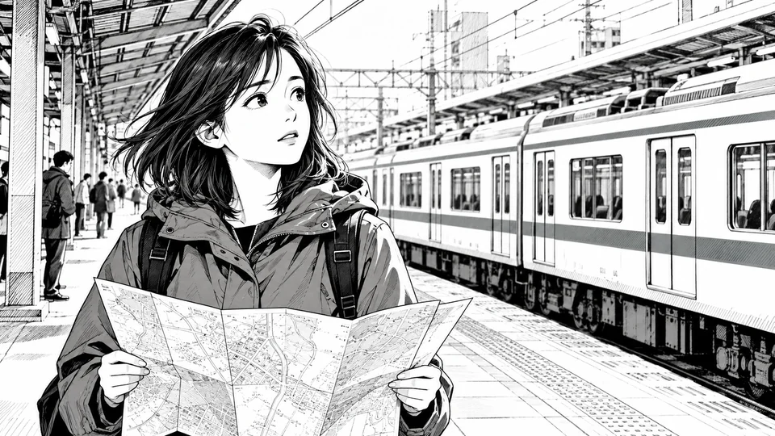

Energetic drawing built from angular contours and decisive ink shadows.

Copy this section by itself after your own subject description. It intentionally does not describe the gallery character or train platform.

```text
Render the supplied subject and scene in the following visual style. Render as energetic black-and-white adventure manga. Use angular pressure-varied pen strokes, pointed contour endings, and a few decisive solid-black shadows. Draw people with compact expressive facial features and slightly emphasized hands when present, while retaining recognizable adult proportions. Organize folds and structural edges into diagonal rhythms without changing the specified pose or scene. Keep faces and hands mostly white and simplify distant surfaces. Use sparse short hatching instead of smooth gray gradients. Follow the separate subject-and-scene description for people, clothing, objects, and setting; do not add them from this style instruction. Do not render text, logos, speech balloons, panel borders, or watermarks. Avoid unrequested combat, weapons, explosions, excessive screentone, and color.
```

**Watch for:** Avoid unrequested combat, weapons, explosions, excessive screentone, and color; these can obscure the technique.

### Round Slapstick Ink

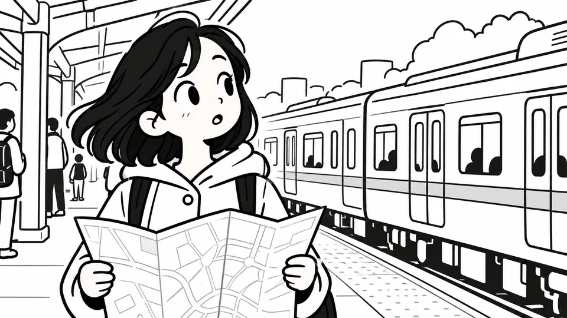

Rubbery rounded forms and big expressions make a scene instantly readable.

Copy this section by itself after your own subject description. It intentionally does not describe the gallery character or train platform.

```text
Render the supplied subject and scene in the following visual style. Render as a playful black-and-white slapstick comic. Use thick elastic curved outlines and simplified bulbous hands and objects. When people appear, give them rounded oversized heads, compact two-and-a-half to three-head-tall bodies, broad open expressions, and small dot-like facial details. Preserve their described age, clothing, and action rather than turning adults into children. Keep interiors mostly white, using tiny solid-black accents and almost no screen tones. Simplify the setting into a few rounded identifying shapes. Follow the separate subject-and-scene description for people, clothing, objects, and setting; do not add them from this style instruction. Do not render text, logos, speech balloons, panel borders, or watermarks. Avoid color fills, realistic anatomy, ornate eyes, extra joke props, and speech balloons.
```

**Watch for:** Avoid color fills, realistic anatomy, ornate eyes, extra joke props, and speech balloons; these can obscure the technique.

### Lyrical Ornamental Manga

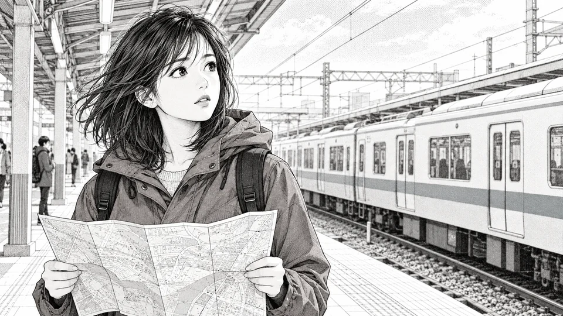

Decorative line rhythm and luminous eyes create an elaborate lyrical mood.

Copy this section by itself after your own subject description. It intentionally does not describe the gallery character or train platform.

```text
Render the supplied subject and scene in the following visual style. Render as richly detailed black-and-white lyrical manga. Use very fine flowing pen lines, elongated graceful proportions when people appear, large luminous eyes built from precise nested ink shapes, and layered ribbons of hair linework. Describe clothing folds with feathered hatching and restrained pale dot-screen tones. Concentrate decorative line rhythms in existing hair, fabric, and scene surfaces; do not add flowers, stars, lace, or new accessories. Let focal highlights and selected background spaces remain white so the fine lines stay legible. Follow the separate subject-and-scene description for people, clothing, objects, and setting; do not add them from this style instruction. Do not render text, logos, speech balloons, panel borders, or watermarks. Avoid color wash, heavy uniform outlines, unrequested decorative objects, and photographic shading.
```

**Watch for:** Avoid color wash, heavy uniform outlines, unrequested decorative objects, and photographic shading; these can obscure the technique.

### Quiet Observational Manga

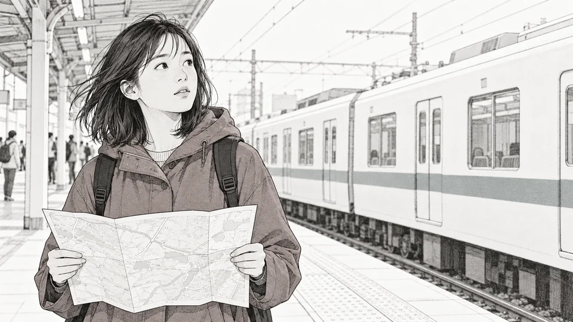

Natural proportions, small gestures, and selective detail give everyday scenes quiet weight.

Copy this section by itself after your own subject description. It intentionally does not describe the gallery character or train platform.

```text
Render the supplied subject and scene in the following visual style. Render as quiet observational black-and-white manga. Use natural adult proportions, small realistic eyes when people appear, and fine understated contours with slight hand-drawn irregularity. Observe posture, hand placement, and small folds carefully. Shade only selected overlaps with short parallel hatching and very light gray dot tones. Leave large paper-white areas untouched and omit nonessential background lines while retaining the specified setting. Avoid dramatic expression conventions; let small gestures carry the scene. Follow the separate subject-and-scene description for people, clothing, objects, and setting; do not add them from this style instruction. Do not render text, logos, speech balloons, panel borders, or watermarks. Avoid large stylized eyes, action effects, dramatic black masses, global gray shading, and photographic rendering.
```

**Watch for:** Avoid large stylized eyes, action effects, dramatic black masses, global gray shading, and photographic rendering; these can obscure the technique.

### Noir Brush Manga

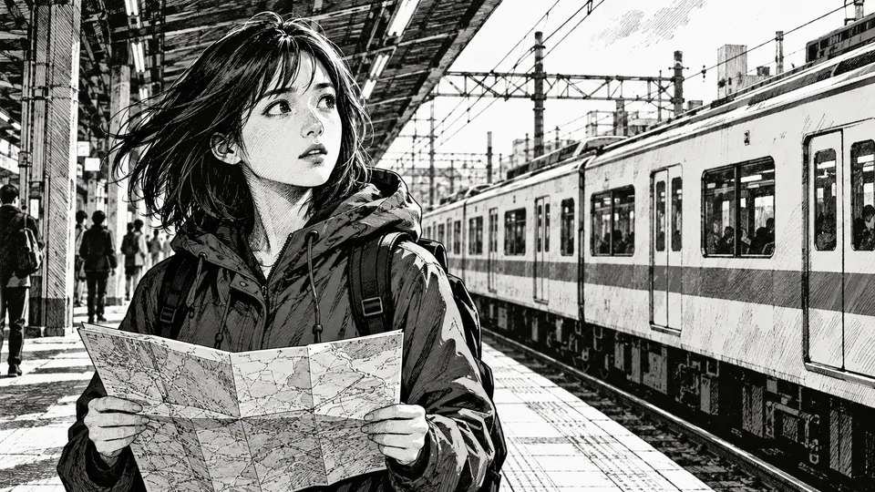

Rugged ink and a few carved highlights give a scene graphic tension.

Copy this section by itself after your own subject description. It intentionally does not describe the gallery character or train platform.

```text
Render the supplied subject and scene in the following visual style. Render as gritty black-and-white noir manga with natural proportions. Use rugged brush-pen contours, dry-ink breaks, and large connected black shadow masses. Carve a few sharp white highlights out of dark hair, fabric, and architecture when those surfaces occur in the subject description. Use short abrasive hatching to join midtones to black, leaving the focal face and hands readable. Preserve the supplied place, action, and time of day; create tension through graphic values rather than adding crime or turning daylight into night. Follow the separate subject-and-scene description for people, clothing, objects, and setting; do not add them from this style instruction. Do not render text, logos, speech balloons, panel borders, or watermarks. Avoid added violence, blood, weapons, night conversion, smooth gray gradients, and uniform noise.
```

**Watch for:** Avoid added violence, blood, weapons, night conversion, smooth gray gradients, and uniform noise; these can obscure the technique.

### Geometric Everyday Comic

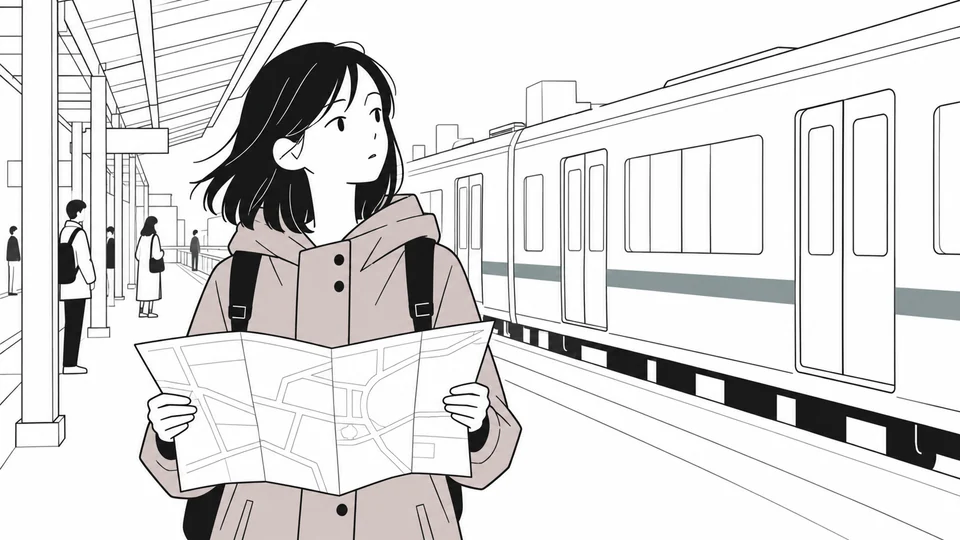

Deadpan expressions and economical geometry give ordinary situations a light comic rhythm.

Copy this section by itself after your own subject description. It intentionally does not describe the gallery character or train platform.

```text
Render the supplied subject and scene in the following visual style. Render as a minimalist black-and-white everyday comic. Use even thin-to-medium outlines, angular geometric silhouettes, and economical straight or gently curved marks. When people appear, keep roughly five-head-tall simplified proportions, tiny facial features, and understated deadpan expressions rather than exaggerated reactions. Represent objects with a few clear planes. Keep almost every interior white, reserving small black shapes for necessary dark materials. Omit nonessential background marks and cast shadows; use spacing and overlaps to keep the specified scene readable. Follow the separate subject-and-scene description for people, clothing, objects, and setting; do not add them from this style instruction. Do not render text, logos, speech balloons, panel borders, or watermarks. Avoid rounded chibi bodies, ornate eyes, textured hatching, dense dot tones, and added comic symbols.
```

**Watch for:** Avoid rounded chibi bodies, ornate eyes, textured hatching, dense dot tones, and added comic symbols; these can obscure the technique. This sample retains faint local color despite the black-and-white instruction. It is the actual generated output, not recolored; strict color constraints can vary between generations.

### Directional Athletic Penwork

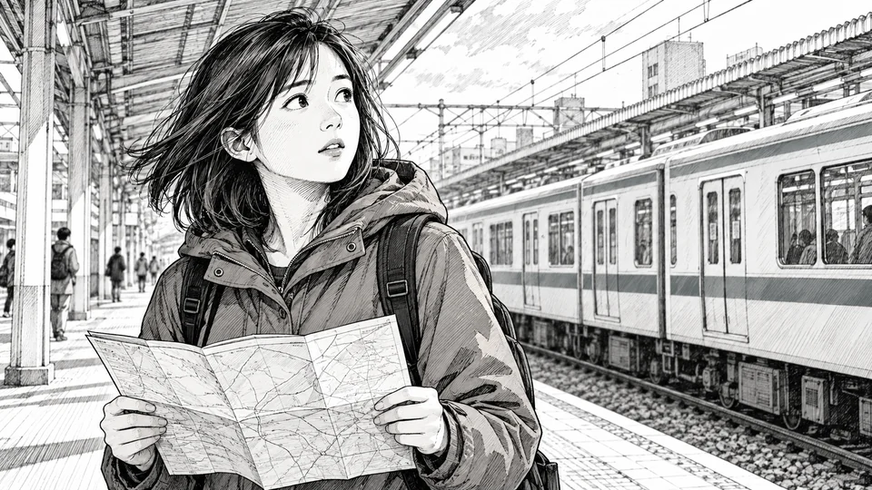

Long directional strokes emphasize body weight and movement without changing the action.

Copy this section by itself after your own subject description. It intentionally does not describe the gallery character or train platform.

```text
Render the supplied subject and scene in the following visual style. Render as black-and-white manga with fluid athletic penwork. Use long tapered strokes that follow body weight, cloth tension, and the perspective of specified objects. When people appear, use lean natural proportions, clear joint structure, and focused small-eyed expressions. Build selected shadows with grouped oblique hatching rather than large black pools or dot screens. Keep the supplied action exactly as described, even when it is quiet: suggest energy through line direction and contour rhythm, not through added running, sports equipment, or speed-effect backgrounds. Follow the separate subject-and-scene description for people, clothing, objects, and setting; do not add them from this style instruction. Do not render text, logos, speech balloons, panel borders, or watermarks. Avoid unrequested sports actions or equipment, explosive effect lines, bulky exaggerated muscles, and smooth grayscale.
```

**Watch for:** Avoid unrequested sports actions or equipment, explosive effect lines, bulky exaggerated muscles, and smooth grayscale; these can obscure the technique.

### Limited-Color Printed Comic

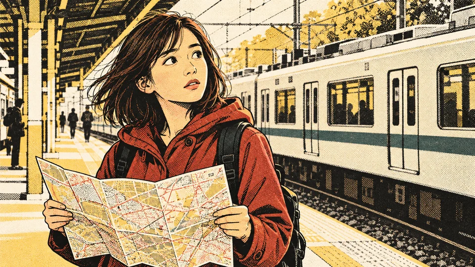

Bold brush drawing and a few visible color plates give a lively printed-comic finish.

Copy this section by itself after your own subject description. It intentionally does not describe the gallery character or train platform.

```text
Render the supplied subject and scene in the following visual style. Render as a limited-color printed comic illustration. Use bold slightly uneven brush outlines, simplified expressive faces with readable adult proportions when present, and broad flat spot-color plates. Use black, warm red, muted yellow, and the white paper only; translate the supplied local colors into this palette without changing the objects. Shade through clearly visible coarse halftone dots in selected color areas. Allow subtle plate-registration drift at a few edges and slight ink coverage variation, while keeping focal facial details crisp. Preserve white highlight shapes and organize the background into broad planes. Follow the separate subject-and-scene description for people, clothing, objects, and setting; do not add them from this style instruction. Do not render text, logos, speech balloons, panel borders, or watermarks. Avoid full-spectrum color, soft airbrush gradients, photographic textures, fake aged stains, and generated lettering.
```

**Watch for:** Avoid full-spectrum color, soft airbrush gradients, photographic textures, fake aged stains, and generated lettering; these can obscure the technique.

### Tensile Sketch Color

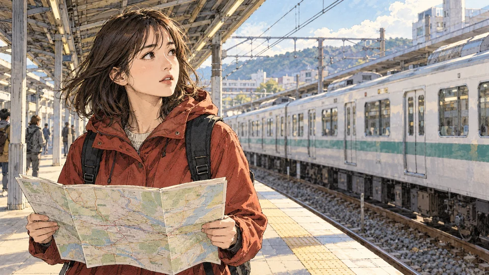

Taut fine drawing and translucent color make body weight and material tension visible.

Copy this section by itself after your own subject description. It intentionally does not describe the gallery character or train platform.

```text
Render the supplied subject and scene in the following visual style. Render as a finely drawn color manga illustration with taut sketch-like energy. Use slender pressure-varied pen contours, small exploratory overlaps, and short directional hatching that follows anatomy, stretched cloth, and object structure. When people appear, use lean believable adult proportions, articulated hands, narrow focused eyes, and expressive eyebrows. Lay translucent local color over the visible drawing, combining restrained cool shadow washes with a few warm saturated accents from existing materials. Keep white glints sharp and the focal drawing detailed; reduce distant contrast. Preserve the specified pose and quiet or active action exactly; show tension through marks rather than adding an athletic scene. Follow the separate subject-and-scene description for people, clothing, objects, and setting; do not add them from this style instruction. Do not render text, logos, speech balloons, panel borders, or watermarks. Avoid mandatory sports equipment, exaggerated muscles, unrelated geometric decoration, smooth glossy skin, and generic speed effects.
```

**Watch for:** Avoid mandatory sports equipment, exaggerated muscles, unrelated geometric decoration, smooth glossy skin, and generic speed effects; these can obscure the technique.

### Soft Forms, Quiet Shadows

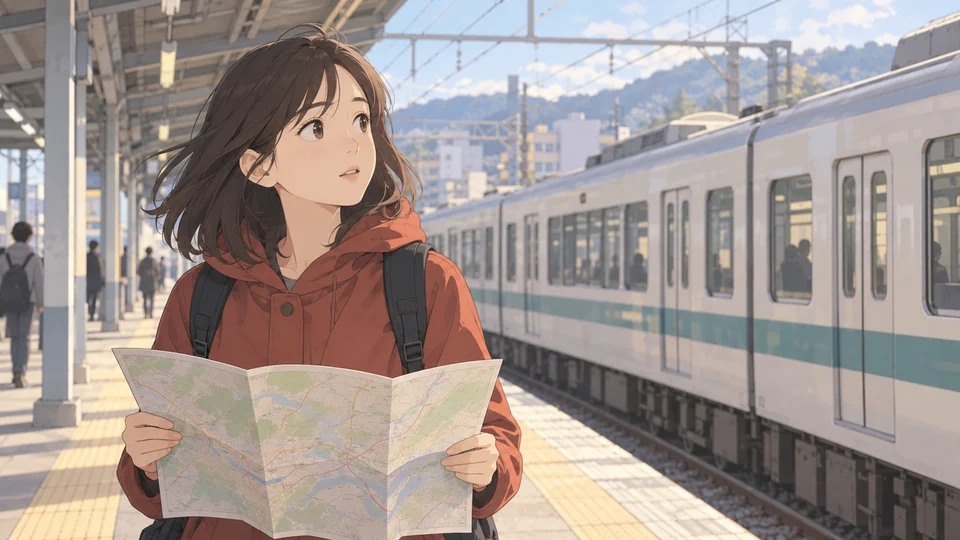

Approachable rounded figures contrast with restrained cool shadows and precise environmental edges.

Copy this section by itself after your own subject description. It intentionally does not describe the gallery character or train platform.

```text
Render the supplied subject and scene in the following visual style. Render as a softly colored manga illustration with rounded approachable character forms and quiet environmental tension. Use fine gently curved outlines, compact but age-appropriate adult proportions when people appear, broad oval eyes with ordinary small catchlights, a small mouth, and simplified hair clumps. Paint with low-saturation local colors, gentle diffuse highlights, and restrained cool gray-violet shadow planes. Keep the character contours soft while drawing a few straight environmental edges clearly. Let small muted shadow areas provide a calm undertone; do not change the supplied scene into horror or add damage. Avoid strong gloss and noisy texture, and keep the background readable without equal detail everywhere. Follow the separate subject-and-scene description for people, clothing, objects, and setting; do not add them from this style instruction. Do not render text, logos, speech balloons, panel borders, or watermarks. Avoid school uniforms or childlike ages not requested, zombies, broken windows, horror props, dramatic black masses, and excessive pastel glow.
```

**Watch for:** Avoid school uniforms or childlike ages not requested, zombies, broken windows, horror props, dramatic black masses, and excessive pastel glow; these can obscure the technique.

### Scruffy Everyday Color

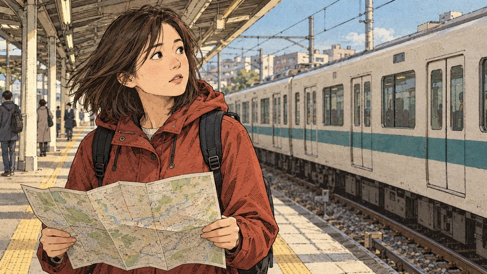

Loose ink, understated expressions, and a little surface roughness give everyday scenes a lived-in comic feel.

Copy this section by itself after your own subject description. It intentionally does not describe the gallery character or train platform.

```text
Render the supplied subject and scene in the following visual style. Render as a casually scruffy color comic. Use uneven fine-to-medium ink outlines with small hooks, quick hair tufts, and slightly imperfect interior lines. When people appear, use recognizable adult proportions with mild caricature, simple half-lidded eyes where compatible with the specified gaze, and understated expressions rather than exaggerated cute smiles. Model cloth and existing worn materials with sparse dry hatching and a few flat muted local-color layers. Leave small gaps in the drawing and let a little paper grain show through the color. Preserve the specified grooming, clothes, objects, and clean or worn setting; create a lived-in feeling through mark making rather than adding dirt or clutter. Follow the separate subject-and-scene description for people, clothing, objects, and setting; do not add them from this style instruction. Do not render text, logos, speech balloons, panel borders, or watermarks. Avoid unrequested animal ears or tails, cigarettes, grime, garbage, childish proportions, glossy airbrush, and polished ornamental linework.
```

**Watch for:** Avoid unrequested animal ears or tails, cigarettes, grime, garbage, childish proportions, glossy airbrush, and polished ornamental linework; these can obscure the technique.

### Clear Luminous Color

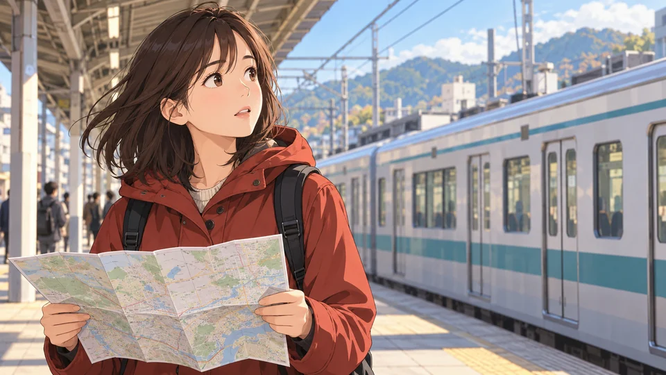

Crisp facial drawing and concentrated luminous color bring the focal expression forward.

Copy this section by itself after your own subject description. It intentionally does not describe the gallery character or train platform.

```text
Render the supplied subject and scene in the following visual style. Render as a crisp luminous color manga illustration. Draw fine precise contours, sharply tapered individual hair groups, a small clearly defined nose and mouth, and large but age-appropriate expressive eyes when people appear. Build irises from concentric color values with ordinary round or rectangular light reflections; never use star-shaped pupils or emblem-like eye symbols. Use saturated local colors for existing focal materials, layered transparent hair color, and clean hard-to-soft cel shadow boundaries. Keep small luminous reflections in the eyes and selected hair strands while leaving skin and cloth mostly matte. Organize the specified background into quiet lower-saturation planes so the focal expression carries the brightness. Follow the separate subject-and-scene description for people, clothing, objects, and setting; do not add them from this style instruction. Do not render text, logos, speech balloons, panel borders, or watermarks. Avoid star-shaped eyes, signature eye emblems, idol costumes or accessories not specified, colored hair not requested, floating glitter, and gloss everywhere.
```

**Watch for:** Avoid star-shaped eyes, signature eye emblems, idol costumes or accessories not specified, colored hair not requested, floating glitter, and gloss everywhere; these can obscure the technique.

### Cinematic Mystery Photo

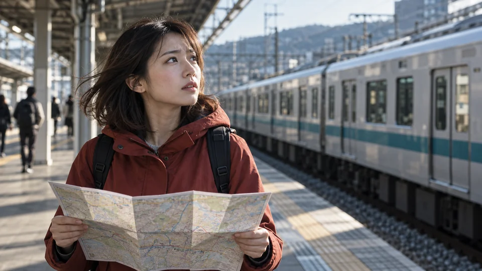

Restrained cool color and layered light suggest unanswered questions without inventing a crime scene.

Copy this section by itself after your own subject description. It intentionally does not describe the gallery character or train platform.

```text
Render as a photorealistic cinematic mystery still with restrained blue-gray color grading, natural human anatomy, visible skin texture, and plausible camera optics. Use directional sidelight from the existing daylight opening to illuminate one side of the subject while the canopy or existing overhead structure creates crisp layered shadows. Keep the shadow side legible with cool fill, neutral whites, restrained warm skin, and a muted warm accent from the supplied objects or clothing. Use a 50mm-lens perspective, moderate depth of field, fine film grain, and clean controlled contrast. Separate the focal subject from receding architectural lines; let small areas of withheld shadow suggest unanswered questions without inventing events. Respect the stated time of day and keep all named objects recognizable. Avoid comic lines, supernatural figures, crime props, added fog, heavy green color casts, crushed featureless blacks, and gratuitous violence. Follow the separate subject-and-scene description for people, clothing, objects, and setting; do not add them from this style instruction. Do not render text, logos, speech balloons, panel borders, or watermarks.
```

**Watch for:** Keep shadows readable and skin natural. Mystery should come from controlled light, not a dark overlay.

### Uneasy Daylight Horror Photo

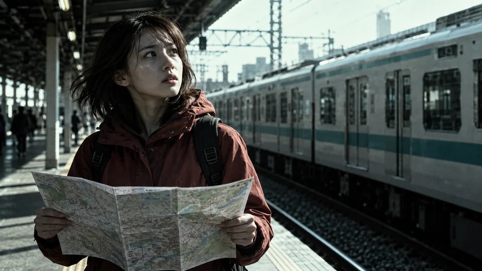

Sickly daylight and sharply divided values create psychological unease while the supplied scene remains intact.

Copy this section by itself after your own subject description. It intentionally does not describe the gallery character or train platform.

```text
Render as a photorealistic psychological-horror film still using uneasy daylight rather than changing the supplied scene to night. Keep real anatomy, visible skin pores, and plausible camera optics. Grade the existing daylight toward pale sickly cyan-green highlights with desaturated gray shadows and a subdued oxidized-red accent from supplied materials. Use a hard narrow side light and very little frontal fill: make strong shadow boundaries across the face and existing structure, with near-black pockets under the canopy but enough edge light to identify every named object. Let the exterior daylight remain unnaturally pale and bright in contrast to oppressive shadowed areas. Use coarse high-ISO film grain, slight halation around hard highlights, and restrained low-level chromatic fringing. Preserve the supplied expression, action, objects, and location; unease comes from light and color, not added creatures or horror props. Avoid illustration, beauty lighting, inviting amber glow, explicit injuries, blood, invented damage, and unrequested figures. Follow the separate subject-and-scene description for people, clothing, objects, and setting; do not add them from this style instruction. Do not render text, logos, speech balloons, panel borders, or watermarks.
```

**Watch for:** A bright benchmark may limit deep-shadow horror. Preserve recognizable objects rather than adding creatures or injuries.

### Taut Pen & Hatching Manga

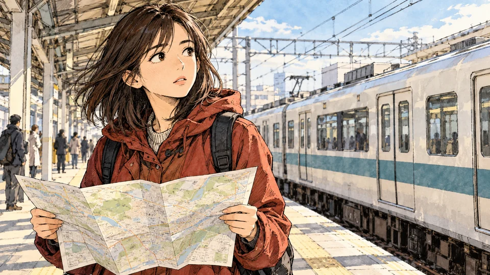

Angular manga construction and assertive pen pressure distinguish this from softly modeled illustration.

Copy this section by itself after your own subject description. It intentionally does not describe the gallery character or train platform.

```text
Render as a Japanese manga color illustration whose drawing is visibly made with a flexible pen. Make the focal contours angular, taut, and strongly pressure-varied: sharp cheek and jaw turns, narrow almond eyes, articulated fingers, and long wedge-shaped hair locks when people appear. Preserve adult age and the specified expression, but simplify the face into a drawn manga construction rather than a realistic portrait. Keep assertive black linework visible through translucent local-color washes. Use short parallel hatching along form, a few hooked exploratory lines, white paper gaps, and concentrated dark accents at overlapping hair and cloth folds. Model the body and existing objects with drawn planes instead of smooth painterly volume. Keep background architecture economical and less detailed than the figure. Show energy through line pressure even in a still scene. Avoid photographic skin, uniformly thin polished outlines, soft all-over airbrush shading, unrelated action or props, and decorative collage. Follow the separate subject-and-scene description for people, clothing, objects, and setting; do not add them from this style instruction. Do not render text, logos, speech balloons, panel borders, or watermarks.
```

**Watch for:** If contours become uniformly thin or skin is realistically modeled, the intended taut drawing is weakened.

### Round-Faced Matte Manga

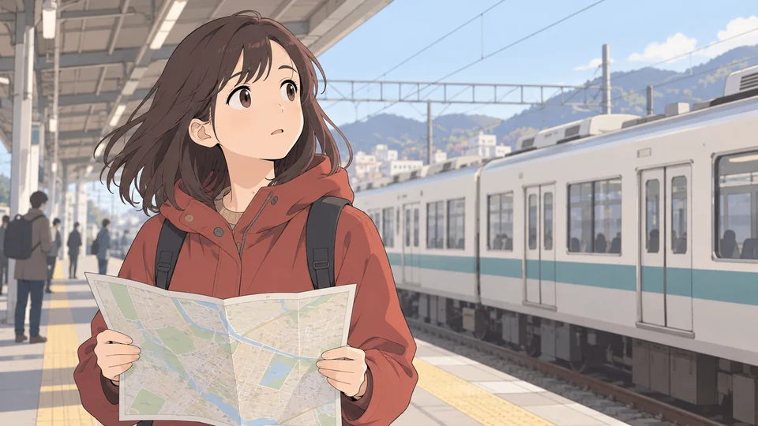

Broad oval manga eyes, rounded cheeks, and minimal modeling make the soft construction readable.

Copy this section by itself after your own subject description. It intentionally does not describe the gallery character or train platform.

```text
Render as a softly colored Japanese manga illustration with unmistakably rounded, simplified character construction. When people appear, draw broad oval manga eyes with substantial dark upper lashes and small ordinary catchlights, softly full cheeks, a tiny nose indicated by one short mark, a small mouth, and a gently rounded chin. Retain adult age, the supplied expression, and clothing. Use clean fine curved ink outlines and simplified round-ended hair clumps. Place pale matte local colors in broad mostly flat regions; use only a few light cool gray-violet shadow shapes beneath the hair and at clothing overlaps. Leave the face largely unshaded, with no realistic skin texture or sculptural portrait modeling. Draw the background with spare straight lines and large quiet color planes so the rounded face is the main visual signal. Keep the scene and physical objects intact. Avoid chibi bodies, glossy painting, dense hatching, dramatic black shadows, monsters, damage, and unrequested costumes. Follow the separate subject-and-scene description for people, clothing, objects, and setting; do not add them from this style instruction. Do not render text, logos, speech balloons, panel borders, or watermarks.
```

**Watch for:** The adult face should remain rounded and simplified; dense shading can turn it back into a generic portrait.

### Bold Scruffy Ink Comic

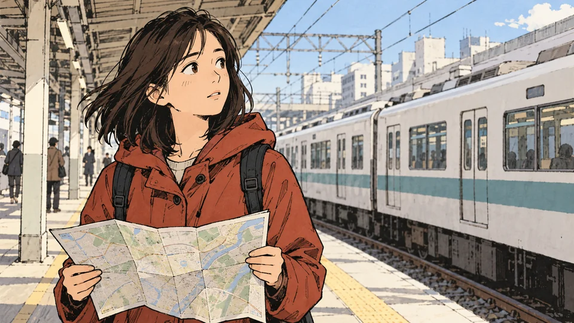

Blunt ink and compact graphic faces show rough comic drawing without adding dirt or clutter.

Copy this section by itself after your own subject description. It intentionally does not describe the gallery character or train platform.

```text
Render as a deliberately rough Japanese everyday comic color illustration. Use visibly uneven medium-to-bold black pen contours with blunt hooks, broken joins, blunt hair tufts, and a few overshooting interior strokes. When people appear, simplify their adult face into compact angular cheeks, small half-lidded manga eyes compatible with the supplied gaze, one-mark nose, and an understated mouth; do not render a realistic portrait. Make the hair and a few overlapping cloth folds read as simple black ink masses, not thousands of fine strands. Fill broad areas with flat muted local colors, leaving white paper gaps and sparse coarse dry hatching in selected folds. Keep large quiet background shapes and lightly irregular architectural lines. Let the hand-drawn imperfections be visible at thumbnail size. Preserve the supplied pose, grooming, clean setting, and objects rather than adding mess. Avoid polished fine-line illustration, smooth gradients, painterly depth everywhere, animal features, cigarettes, and added clutter. Follow the separate subject-and-scene description for people, clothing, objects, and setting; do not add them from this style instruction. Do not render text, logos, speech balloons, panel borders, or watermarks.
```

**Watch for:** If it becomes a fine realistic sketch, the blunt uneven contour and flat comic color are missing.

### Crisp Cel & Hair Highlights

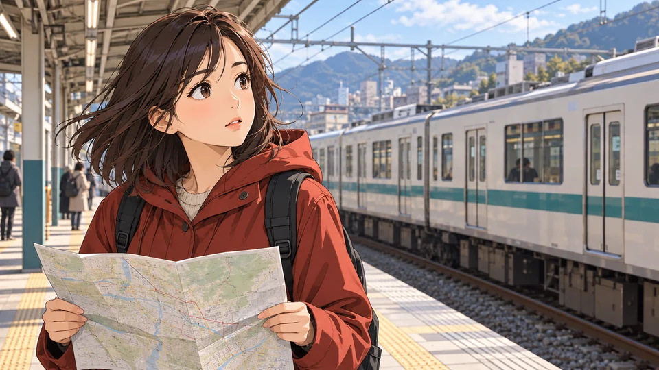

Graphic manga eyes and controlled jewel-like color concentrate brightness at the expression.

Copy this section by itself after your own subject description. It intentionally does not describe the gallery character or train platform.

```text
Render as a crisp contemporary Japanese manga color illustration with precise graphic facial construction and concentrated jewel-like color. When people appear, draw large almond-shaped manga eyes with thick sharply tapered upper lash contours, clear multilayer iris rings, and two ordinary geometric light reflections; use a tiny nose and small precise mouth, retaining adult age and the specified expression. Draw hair as clean tapered ribbon groups, separated by sharply controlled fine ink lines and narrow cool-violet reflected highlights without changing its base color. Use saturated local colors for the supplied focal materials, crisp cel-shadow shapes, selective transparent color layering, and restrained pink reflected light on cheeks. Keep skin mostly matte and simplified rather than realistically modeled. Make eyes and selected hair reflections luminous, with quiet low-saturation background planes and sharply readable silhouettes. Avoid star-shaped pupils, emblem-like eye marks, floating glitter, unrequested costumes or hair colors, painterly line loss, and gloss over every surface. Follow the separate subject-and-scene description for people, clothing, objects, and setting; do not add them from this style instruction. Do not render text, logos, speech balloons, panel borders, or watermarks.
```

**Watch for:** Ordinary reflections should carry the brightness; avoid signature eye symbols and all-over gloss.

### Reportage Ink & Spot Color

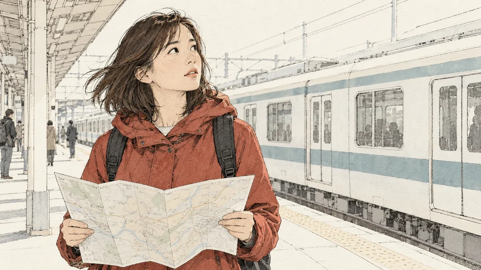

A restrained documentary illustration for everyday human drama, with an adult figure and readable architecture rather than manga construction.

Copy this section by itself after your own subject description. It intentionally does not describe the gallery character or train platform.

```text
Render a hand-drawn documentary editorial illustration. When people appear, use natural adult proportions, small anatomically plausible eyes, an understated mouth, and an individual readable expression rather than anime or manga facial construction. Draw with a dry steel nib: fine slightly broken contours, a few uneven short marks, and selective near-black solid shapes at overlaps. Make most surfaces unshaded ivory paper; use a restrained rust-red accent from the supplied subject and very pale cool gray only where needed to separate planes. Describe architecture with economical straight pen lines, omitting repeated distant detail. Keep the focal face and hands legible, with broad open paper areas elsewhere. The drawing should feel observed, serious, and humane. Avoid all-over crosshatching, engraved line density, woodcut carving, screen-tone dots, photographic modeling, and decorative poster silhouettes. Keep the supplied subject, age, expression, clothing, objects, and setting from the independent scene instruction. Do not add narrative props, decorative motifs, text, logos, borders, or watermarks.
```

**Watch for:** The selected sample leaves pale surfaces and sky open, but background architecture and map markings are more detailed, and the warm accent larger, than the sparse prompt requests. This is one illustration result, not a guaranteed density level.

### Loose Contours & Flat Color

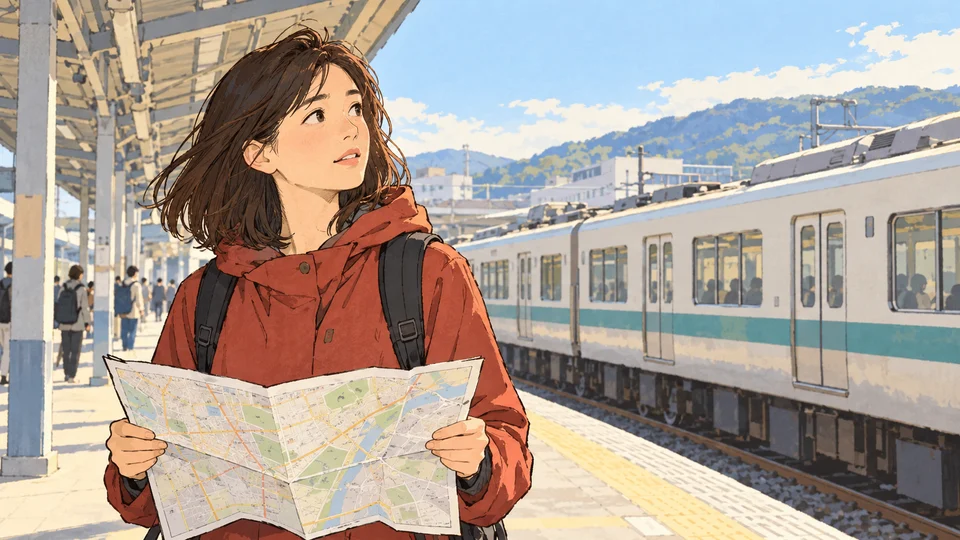

An approachable everyday illustration with mature faces, irregular contours, and lively flat paint; a different construction from rounded manga eyes.

Copy this section by itself after your own subject description. It intentionally does not describe the gallery character or train platform.

```text
Render a lively hand-drawn everyday editorial illustration for an adult audience. Use a loose medium-fine dark brown contour that meanders gently, occasionally loops, and sometimes doubles back around hair, cuffs, and existing objects. Keep adult faces naturally proportioned with small eyes, a clearly drawn nose, modest mouth, and subtle asymmetry; do not use anime eyes or chibi bodies. Fill existing forms with bright but restrained opaque matte color patches: rust red, muted teal, buttery cream, and slate blue, while retaining supplied local colors. Paint slightly uneven edges and allow tiny paper gaps between line and color. Use almost no volume shading: a few small flat shadows at overlaps, no gradients or polished skin. Simplify distant structures into broad readable planes. Keep hair and cloth as casually outlined shapes, not decorative strands or hatching. Leave quiet sky and surface areas free of repeated detail. Avoid geometrically perfect vector shapes, glossy cel highlights, thick comic outlines, and dense decorative collage. Keep the supplied subject, age, expression, clothing, objects, and setting from the independent scene instruction. Do not add narrative props, decorative motifs, text, logos, borders, or watermarks.
```

**Watch for:** This selected sample shows flat color and hand-drawn edges, but its contours are more controlled and its background shadows stronger than the loosely looping, minimally shaded prompt requests.

### Broad Oil-Pastel Narrative

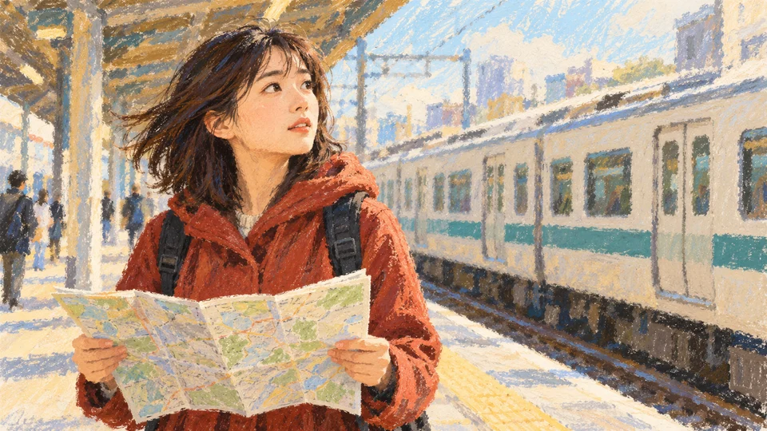

Broad oil-pastel marks convey human presence through warm and cool planes; the coarse waxy strokes differ from fine colored-pencil or powder pastel.

Copy this section by itself after your own subject description. It intentionally does not describe the gallery character or train platform.

```text
Render an original narrative illustration made with broad oil-pastel sticks on lightly textured cream paper. Keep people recognizably adult with natural facial proportions and a restrained expression, without anime construction or photographic skin. Build the image from chunky waxy strokes and flattened blocks of local color; show broken heavy pigment deposits, blunt stroke ends, and cream paper peeking through scumbled overlaps. Use warm rust, ochre, slate blue, muted teal, and soft cream in adjacent warm and cool planes. Model the focal face and hands with a few deliberate smaller pastel strokes, not smooth blending. Let hair, clothing, architecture, and the train remain broad simplified masses with visible stroke direction. Omit ink outlines, fine pencil hatching, thin translucent washes, fuzzy powder shading, and oil-paint canvas impasto. Keep large areas quiet and lightly marked, with concentrated pigment at the subject. Preserve scene legibility without filling every surface with texture. Keep the supplied subject, age, expression, clothing, objects, and setting from the independent scene instruction. Do not add narrative props, decorative motifs, text, logos, borders, or watermarks.
```

**Watch for:** Small fingers and map markings are simplified; waxy pigment should remain visible rather than becoming smooth paint.

### Blue Ballpoint & Warm Accent

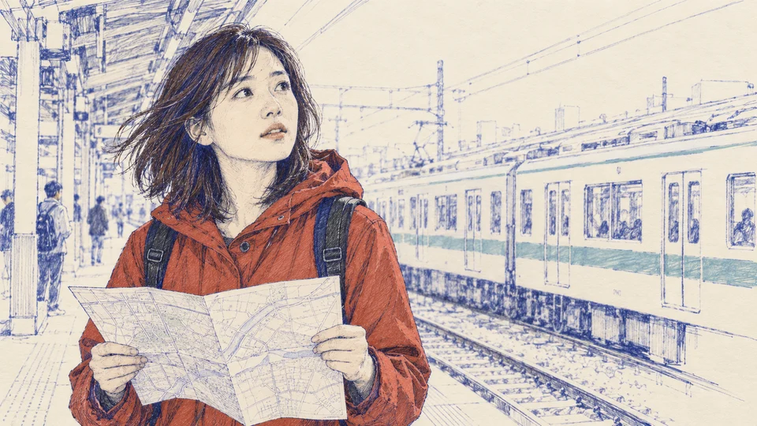

A notebook-like observational treatment with cobalt ballpoint marks and a small warm color accent, suited to intimate everyday narratives.

Copy this section by itself after your own subject description. It intentionally does not describe the gallery character or train platform.

```text
Render an observational adult editorial illustration drawn with a blue ballpoint pen on clean cream paper, with a small rust-red flat accent on the supplied warm-colored clothing. Use fine consistent cobalt-blue lines that overlap, loop, and accumulate at selected hair and cloth edges; show tiny pen-darkened nodes, not black flexible-nib pressure strokes. When people appear, retain adult natural facial proportions, small eyes, an articulated nose, and a quiet individual expression, avoiding manga anatomy. Build a few midtones from sparse short blue parallel strokes while leaving most skin, sky, and broad surfaces untouched paper. Keep the focal face and hands complete enough to read, but omit distant repeated architecture and train detail with deliberate gaps in the drawing. Warm color occupies only a limited area and is unshaded. Do not use graphite rubs, engraved crosshatching, ink wash, soft gradients, photorealistic skin, full-color rendering, or general blur. The result should feel intimate, precise in observation, and lightly unfinished. Keep the supplied subject, age, expression, clothing, objects, and setting from the independent scene instruction. Do not add narrative props, decorative motifs, text, logos, borders, or watermarks.
```

**Watch for:** The selected sample leaves pale surfaces and sky open, but background architecture and map markings are more detailed, and the warm accent larger, than the sparse prompt requests. This is one illustration result, not a guaranteed density level.

### Stippled Duotone Illustration

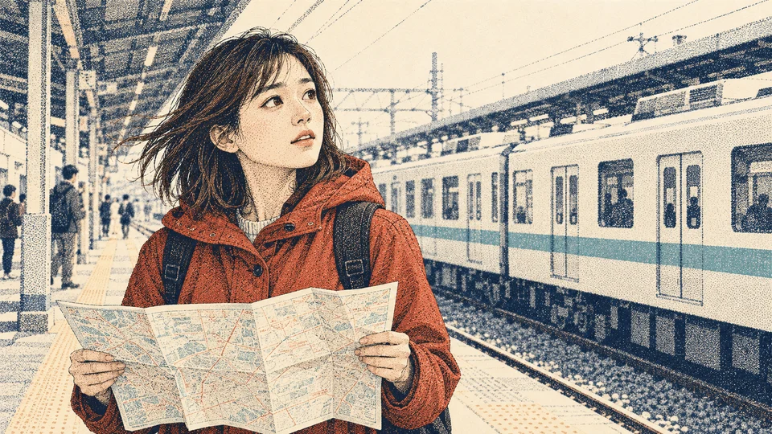

A sober graphic illustration for social drama, using hand-stippled value rather than mechanical risograph screens or manga hatching.

Copy this section by itself after your own subject description. It intentionally does not describe the gallery character or train platform.

```text
Render a carefully hand-stippled adult editorial illustration in deep navy and restrained rust red on warm cream paper. Describe people with natural adult proportions and small realistic drawn eyes, without anime simplification or photographic skin. Use clean economical navy contours and many tiny irregular hand-placed dots to build selected cheek, hair, fabric, and structural shadows; vary dot density rather than using crosshatching or airbrush gradients. Keep the dots visibly individual, nonuniform, and clustered along form rather than a mechanical halftone grid. Introduce restrained flat rust-red planes in the supplied warm-colored subject; use pale teal sparingly to preserve the supplied train stripe. Leave highlights and broad sky regions as clear cream paper. Concentrate fine dots at the figure and a few architectural overlaps, with simpler background planes to avoid uniform density. Avoid risograph registration drift, coarse screen-tone patterns, engraving lines, wood grain, decorative typography, and added motifs. Keep the supplied subject, age, expression, clothing, objects, and setting from the independent scene instruction. Do not add narrative props, decorative motifs, text, logos, borders, or watermarks.
```

**Watch for:** The sample shows fine navy dot values and rust color, but dots extend into the background more widely than requested. At small sizes, dense dots in hair merge into dark masses.

### Bold Cutout Silhouettes


Cut edges and long-necked adult geometry replace observational anatomy and detailed penwork.

Copy this section by itself after your own subject description. It intentionally does not describe the gallery character or train platform.

```text
Build the illustration entirely from boldly simplified cut-paper-like silhouettes on clean ivory. Use rust red, deep charcoal and pale teal plus paper white, with no tonal gradients. Make the adult figure a long narrow head shape on an exaggerated thin neck, a large angular coat block, two mitten-shaped hands and a single black backpack shape. Let the nose be one notch in the profile and the upward-looking eye be one tiny brown dot; omit mouth, cheeks, lashes and all portrait modeling. Hair is one solid asymmetric shape with at most two projecting tips. There are no drawn interior contours. Use sharp cut edges and slightly irregular broad shapes, not physical paper shadows or fibrous collage texture. Keep at least half the total frame plain untouched ivory, including a continuous open band around the figure and above the train. The background is a handful of long horizontal and diagonal cut shapes, subordinate to the figure. Think abstract adult editorial graphic, not manga, scenic travel painting or realistic book-cover portrait. Treat the separate scene description as a list of semantic elements to depict, never as a request for realistic rendering or detailed portraiture. Its woman, map, backpack, canopy, distant commuters and white train with teal stripe must remain recognizable, but radically simplify their shapes. Depict the adult woman looking up to the right and holding the open map with both simplified hands; keep the same broad placement and view. Show the map as a plain folded polygon with at most three broad abstract route marks, no street network. Show the train as one long flat white or paper-white band with its teal stripe and no more than three simple window marks; omit roof equipment, wheels, rails, bolts, cables, signs and repeated window detail. Reduce the canopy to one diagonal and two supports, and the distant people to at most two tiny marks. No clothing seams, buttons, anatomical fingers, individual hair strands, skin modeling, realistic eyelids, tiny reflections, scenic foliage or all-over shading. Omission and deformation are essential, not low resolution or blur. Keep supplied clothing and objects as recognizable simplified symbols; add no props, text, logos, borders or watermarks.
```

**Watch for:** The sample clearly simplifies face, hands and architecture, though it uses a few more muted color planes than the three-color target.

### Elastic Everyday Symbols

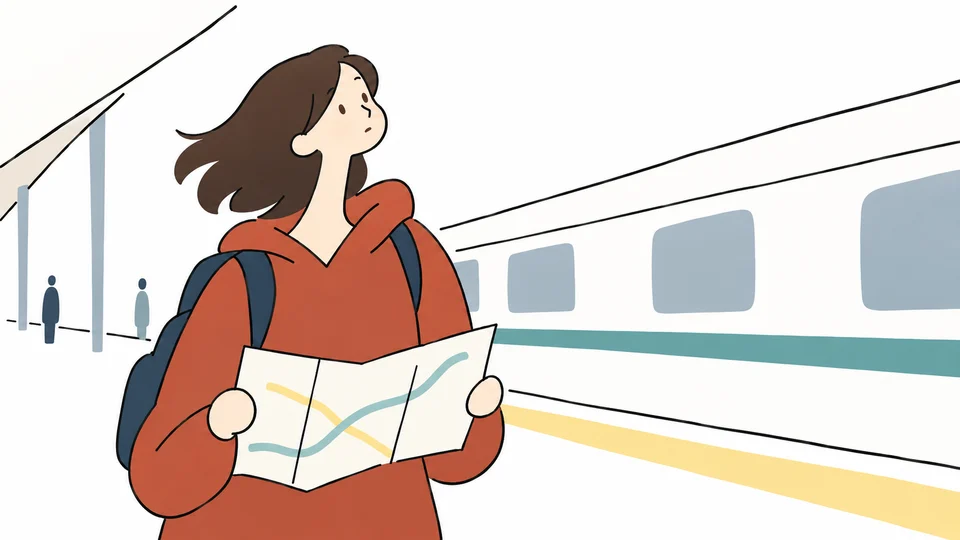

A small head, long neck and tube-like arms make the deformation visible; facial expression is conveyed by only a few marks.

Copy this section by itself after your own subject description. It intentionally does not describe the gallery character or train platform.

```text
Draw a playful but adult editorial character illustration with conspicuously elastic, deliberately disproportionate construction. Use a tiny rounded head, an exaggerated long curved neck, broad shoulders, an oversized simple coat, long bent tube-like forearms, and round mitten hands. The face has only two small brown dots, one short L-shaped nose and one tiny mouth dash; no lashes, cheek modeling or lifelike portrait. Hair is one casually curved mass with three outward tufts, without inner strands. Draw loose thin black contours with occasional open joins and wobble around these distorted shapes. Fill only selected isolated regions with flat rust red, muted teal, dark blue and pale yellow. White paper remains the majority of the frame; omit cast shadows, gradients, volume and surface texture. Clothing is a single unshaded color island, not a study of folds. Simplify existing environment into crooked minimal diagram-like symbols. Do not turn this into chibi anime with a large head, a realistic figure with bright paint, or a fully rendered cartoon background. Treat the separate scene description as a list of semantic elements to depict, never as a request for realistic rendering or detailed portraiture. Its woman, map, backpack, canopy, distant commuters and white train with teal stripe must remain recognizable, but radically simplify their shapes. Depict the adult woman looking up to the right and holding the open map with both simplified hands; keep the same broad placement and view. Show the map as a plain folded polygon with at most three broad abstract route marks, no street network. Show the train as one long flat white or paper-white band with its teal stripe and no more than three simple window marks; omit roof equipment, wheels, rails, bolts, cables, signs and repeated window detail. Reduce the canopy to one diagonal and two supports, and the distant people to at most two tiny marks. No clothing seams, buttons, anatomical fingers, individual hair strands, skin modeling, realistic eyelids, tiny reflections, scenic foliage or all-over shading. Omission and deformation are essential, not low resolution or blur. Keep supplied clothing and objects as recognizable simplified symbols; add no props, text, logos, borders or watermarks.
```

**Watch for:** The small head, long neck and round hands are visible; arm deformation is gentler than the tube-like construction requested.

### Chunky Wax Shapes

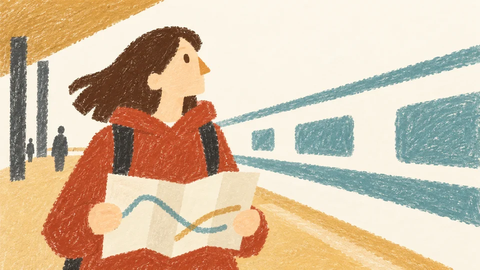

Broad primitive shapes replace the original pastel sample’s small modeled strokes; wax breaks remain only inside large masses.

Copy this section by itself after your own subject description. It intentionally does not describe the gallery character or train platform.

```text
Make a radically simplified primitive editorial illustration drawn only with very broad wax crayon marks. The whole figure is assembled from a large rounded-square head, triangular nose, one tiny brown eye dot looking right, a single crescent hair block, a trapezoid coat and two stubby mitten hands. Exaggerate the coat width and reduce adult anatomy to bold block shapes; keep an adult attitude rather than realistic anatomy or a cute anime face. Use no more than five broad color masses: rust red, charcoal, cream, muted teal and warm ochre. Every mark is thick and blunt, visibly at least a finger-width relative to the figure; there are no fine strokes, hatching, outlines, small facial features or smoothly blended modeled skin. Leave broken wax coverage inside broad flat masses but do not use texture to recreate realistic detail. The map is a large pale zigzag shape. Background structures are just broad crayon bars over large unmarked cream areas. Concentrate visual weight in the figure while roughly half the picture remains clear paper. This is a bold shape design using wax marks, not a painterly realistic pastel portrait. Treat the separate scene description as a list of semantic elements to depict, never as a request for realistic rendering or detailed portraiture. Its woman, map, backpack, canopy, distant commuters and white train with teal stripe must remain recognizable, but radically simplify their shapes. Depict the adult woman looking up to the right and holding the open map with both simplified hands; keep the same broad placement and view. Show the map as a plain folded polygon with at most three broad abstract route marks, no street network. Show the train as one long flat white or paper-white band with its teal stripe and no more than three simple window marks; omit roof equipment, wheels, rails, bolts, cables, signs and repeated window detail. Reduce the canopy to one diagonal and two supports, and the distant people to at most two tiny marks. No clothing seams, buttons, anatomical fingers, individual hair strands, skin modeling, realistic eyelids, tiny reflections, scenic foliage or all-over shading. Omission and deformation are essential, not low resolution or blur. Keep supplied clothing and objects as recognizable simplified symbols; add no props, text, logos, borders or watermarks.
```

**Watch for:** The selected output shows blunt shape blocks and no modeled face; grain remains inside the large filled regions, so it is less empty than the line option.

### Spare Continuous-Line Design


Unfilled loops and absent fingers, folds, and window repetition are intentional; the scene remains a readable symbol.

Copy this section by itself after your own subject description. It intentionally does not describe the gallery character or train platform.

```text
Render an extremely spare adult editorial line design on pure white. Use a few long continuous cobalt-blue monoline loops to suggest the figure with deliberate missing contour sections. The adult head is an elongated oval with a simple nose kink and one small brown eye dash looking right, no detailed mouth or eye anatomy. Hair is two broad sweeping loops and an unfilled oval gap, never a mesh of strands. Body and limbs are stylized long curves; hands are two small oval hooks touching the map, without fingers. Use at most about twenty substantial strokes for the entire image, counting background marks; do not sneak in short marks, distant hatching or micro-detail. All forms remain unfilled except one small flat rust-red patch on part of the coat and a thin pale teal train stripe. The rest of the coat, face and hair are blank white. Reduce background to a few incomplete straight marks; most of the train has no outline. Leave roughly three quarters of the frame clear white. This must read as a minimal continuous-line editorial drawing or pictogram, not a detailed ballpoint sketch, anatomical portrait, architectural sketch or blue pen rendering of a photograph. Treat the separate scene description as a list of semantic elements to depict, never as a request for realistic rendering or detailed portraiture. Its woman, map, backpack, canopy, distant commuters and white train with teal stripe must remain recognizable, but radically simplify their shapes. Depict the adult woman looking up to the right and holding the open map with both simplified hands; keep the same broad placement and view. Show the map as a plain folded polygon with at most three broad abstract route marks, no street network. Show the train as one long flat white or paper-white band with its teal stripe and no more than three simple window marks; omit roof equipment, wheels, rails, bolts, cables, signs and repeated window detail. Reduce the canopy to one diagonal and two supports, and the distant people to at most two tiny marks. No clothing seams, buttons, anatomical fingers, individual hair strands, skin modeling, realistic eyelids, tiny reflections, scenic foliage or all-over shading. Omission and deformation are essential, not low resolution or blur. Keep supplied clothing and objects as recognizable simplified symbols; add no props, text, logos, borders or watermarks.
```

**Watch for:** The sample omits realistic portrait and architectural detail, but contains more than the approximate twenty-stroke target.

### Modular Shapes & Oversized Dots


A few large dot accents replace the earlier image’s dense fine stippling; simplified modules replace portrait and architecture detail.

Copy this section by itself after your own subject description. It intentionally does not describe the gallery character or train platform.

```text
Design a radically reduced modern adult editorial graphic from modular flat silhouettes on ivory white. Use a circular adult head with an angular profile notch, one tiny brown eye dot aimed upward to the right and no other facial features. Hair is one solid navy semicircle. Give the figure a deliberately exaggerated long neck, a very broad trapezoid coat, skinny curved forearms and simple semicircle mitten hands. Use large rust-red and navy flat shapes with paper-white cutouts and a narrow pale teal stripe only for the specified train. At two or three selected overlaps, replace a shadow with a small cluster of conspicuously oversized navy dots, each approximately the size of the eye or larger; use no more than twenty-four shadow dots in the whole picture. No fine stippling, halftone screens, uniform texture, gradients, natural skin modeling or interior clothing detail. Keep the face a blank light circle with minimal symbol marks. Background is composed of at most six simple bars and rectangles with big open gaps; retain roughly two thirds of the frame as plain ivory. The purpose is a bold modular design with a few playful dot accents, not a detailed pointillist illustration or full-scene screenprint. Treat the separate scene description as a list of semantic elements to depict, never as a request for realistic rendering or detailed portraiture. Its woman, map, backpack, canopy, distant commuters and white train with teal stripe must remain recognizable, but radically simplify their shapes. Depict the adult woman looking up to the right and holding the open map with both simplified hands; keep the same broad placement and view. Show the map as a plain folded polygon with at most three broad abstract route marks, no street network. Show the train as one long flat white or paper-white band with its teal stripe and no more than three simple window marks; omit roof equipment, wheels, rails, bolts, cables, signs and repeated window detail. Reduce the canopy to one diagonal and two supports, and the distant people to at most two tiny marks. No clothing seams, buttons, anatomical fingers, individual hair strands, skin modeling, realistic eyelids, tiny reflections, scenic foliage or all-over shading. Omission and deformation are essential, not low resolution or blur. Keep supplied clothing and objects as recognizable simplified symbols; add no props, text, logos, borders or watermarks.
```

**Watch for:** The flat figure and background are strongly simplified. This sample overlaps the cutout option in silhouette language; its dot accents are few.
