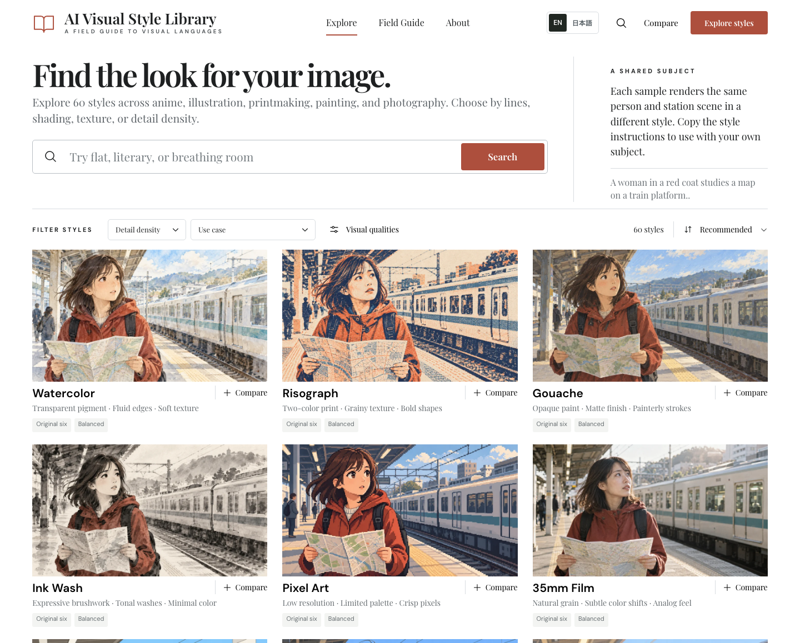

# AI Visual Style Library

A visual prompt library for choosing a drawing or photographic treatment, comparing generated samples, and copying English instructions into your own image-generation AI.

**[Explore the live library →](https://avsl.4roz.com/)** · [日本語 UI](https://avsl.4roz.com/?lang=ja) · [English UI](https://avsl.4roz.com/?lang=en)

[](https://ko-fi.com/yo4e)



The English interface on the live site. Samples share one subject and scene so you can compare their visual treatments.

## Choose a look, then make it your own

1. Browse **75 styles** or filter by visual family and detail density. Search for qualities such as fine lines, flat color, paper texture, or photography.
2. Open a sample to read its line, shading, and texture traits. Select two to four styles to compare them on the same subject.
3. Copy the **Style prompt** for your own subject, the **Subject, scene & composition prompt** used in the sample, or the combined instructions.
4. Paste the instructions into your image-generation tool and adapt the subject or scene there.

The site does not generate images. It offers English and Japanese explanations; copy-ready prompts remain English in both interfaces. The language choice is remembered locally, and `?lang=en` or `?lang=ja` overrides it.

The catalog covers watercolor and other original techniques, anime, manga/comics, light-novel illustration, literary illustration, photography, and general-fiction illustration. Filter by visual family or choose a detail density, from deliberately sparse drawing to rich detail. All 75 existing styles remain available; some visual treatments overlap.

日本語でも絵柄の説明・検索・比較を利用できます。コピーするプロンプトは英語です。[日本語のライブラリ](https://avsl.4roz.com/?lang=ja)で絵柄を選び、自分の画像生成AIに貼り付けて使ってください。

## What the samples demonstrate

Every sample uses the same benchmark subject and scene so that differences in rendering are easier to compare. Style instructions are separate from the subject, pose, setting, and composition; you can reuse the technique with different content.

The copy-ready combined instructions match the submitted text recorded for each selected output in [the benchmark manifest](site/benchmark-manifest.json). Prompt snapshots and generation records are kept in [site/provenance](site/provenance/). Samples are actual generated outputs, resized and compressed as WebP; they are not proof that a prompt will reproduce the same image or degree of stylization on another run. Results vary with the image tool, model, settings, subject, and generation. Some treatments overlap, and the geometric everyday comic sample retains faint color despite its black-and-white instruction, as disclosed in its description.

See the text-only [Prompt Library](PROMPT_LIBRARY.md) for the same English recipes. The [design notes](DESIGN.md) describe a broader future direction; the runnable site is the current implementation.

## Run locally

The app is React with Vite. Use a recent supported Node.js release and npm.

```sh
cd site
npm ci
npm run dev
```

Create and validate the production build:

```sh
npm run build
npm run test:prompts
npm run test:library
npm run test:sites
npm run test:seo
```

`npm run preview` serves the built app locally. Style data lives in [site/src/style-data.js](site/src/style-data.js) and its imported modules; UI translations live in [site/src/i18n.jsx](site/src/i18n.jsx).

The crawl files live in `site/public/sitemap.xml` and `site/public/robots.txt`; Vite copies them into `dist/client` as static files. The sitemap currently contains only `https://avsl.4roz.com/`. Language (`?lang=ja/en`), style (`?style=…`), comparison queries, and section fragments are views of that same canonical page, not separate indexable pages. When real static pages with self canonicals are added, update the sitemap with their canonical URLs. `test:seo` compares the sitemap with the built indexable HTML pages and checks the robots reference and Sites asset handling. Omit `lastmod` unless an actual content modification date is available.

The page title stays **AI Visual Style Library** in both display languages. The initial HTML provides an English description and Open Graph/Twitter sharing metadata; switching languages updates the descriptions in the browser. This remains one query-based app, so it does not expose separate Japanese and English indexable pages. Metadata improves the description of the site; search rankings and traffic must be measured separately.

The larger bilingual static-page prototype is preserved on [`archive/bilingual-static-seo-prototype`](https://github.com/yo4e/AI-Visual-Style-Library/tree/archive/bilingual-static-seo-prototype) for future evaluation. It is not part of the current app.

## Update samples and publish

Finalize the English style and scene instructions before generation. Generate a separate sample for each treatment using its exact combined text, inspect it against the intended line/form/shading traits, and record the submitted prompt and source/output hashes. Keep unrelated examples and existing provenance intact. `npm run export:prompts` refreshes the Markdown prompt library. Integrity tests compare the current prompt text and served image bytes with the manifest.

The generic `npm run sync:benchmark -- /absolute/path/to/source-pngs` command rebuilds the entire benchmark set from `{style-slug}.png` sources. Use a targeted importer when adding only a few styles, rather than rewriting the unchanged samples. Existing import scripts are in [site/scripts](site/scripts/).

Cloudflare Pages uses direct uploads; a GitHub push does not deploy automatically. After building, deploy **only `site/dist/client`**. From `site/`, with an already authorized Cloudflare account:

```sh
npx wrangler pages deploy dist/client --project-name ai-visual-style-library --branch main
```

The [Pages fallback URL](https://ai-visual-style-library.pages.dev/) serves the same site. The additional Sites worker packaging in `dist/server` and `dist/.openai` remains separate. Source PNGs, credentials, and private workspace or reference files are not part of the public deployment.

## License

Project-owned source code and prompt documentation are available under the [MIT License](LICENSE). Third-party dependencies and icon vectors retain their original licenses; see [Third-party notices](THIRD_PARTY_NOTICES.md). The book favicon and coffee icon derive from Phosphor Icons.

The gallery contains AI-generated demonstration images. The MIT license does not establish whether a generated image has copyright protection, grant exclusive rights, or guarantee suitability or clearance for a particular use. Check the terms of the image-generation service you use and review your outputs for your intended publication.

## Support

If you found this useful, buy the developer a coffee. 支援する場合は、開発者にコーヒーをおごってください。

[](https://ko-fi.com/yo4e)
